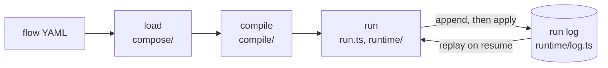

# Architecture

yian turns a YAML flow into a fixed graph, runs the graph, and writes every step of the run to an
append-only log. This file maps that pipeline onto `src/` and lists the rules the code relies on.
For what a run log holds and how a resume works, from a user's side, read the
[How yian works](https://yian.readthedocs.io/how-it-works/) page.

## The pipeline

1. **Load.** `loadFlow` (`compose/loader.ts`) parses the YAML, desugars it, builds each node and
   checks types, expressions and wiring. Any error is a `LoadError`, and nothing runs.
2. **Compile.** `compile/` turns the result into a `CompiledFlow`: the graph, the output
   contracts, the LLM config cascade, the memory layout and a fingerprint. It also builds the
   fragments `call`, `map` and `loop` grow into at run time.
3. **Run.** `runFlow` and `advance` (`run.ts`) start or continue a run. `FlowEngine`
   (`runtime/engine.ts`) picks ready nodes, evaluates them (`runtime/eval_node.ts`), and turns
   each outcome into records through `RunState` (`runtime/state.ts`).
4. **Log.** Each record is appended to the run log, a JSON Lines file, before the state changes.
   `inspectRun`, the run index, resumes and learning all read the log.

## `src/`

| Entry | What it holds |
|---|---|
| `index.ts` | The package root: what a host needs to load, run and extend a flow |
| `run.ts` | The run boundary: `runFlow`, `advance`, `inspectRun`, and the host calls on a log (`send`, `complete`, `close`, `withdraw`, `interrupt`, `cancel`) |
| `compose/` | The YAML loader: source reading (`source/`, `parse/`), desugaring, per-kind node builders (`nodes/`), edges and validation |
| `compile/` | The compiled flow, its validation, growth (`expand.ts`), origins and the fingerprint |
| `nodes/` | One folder per node kind (`agent`, `call`, `case`, `code`, `end`, `loop`, `map`, `start`, `tool`) and the node base contract (`base.ts`) |
| `runtime/` | The engine, run state and its reducer, the record vocabulary and codec (`log.ts`), waits, backward and learning, the run index |
| `expr/` | The `${...}` expression engine, templates and built-in functions |
| `typesys/` | Typed values, the type language, the variable pool and the JSON codec |
| `diagnostics.ts` | Failures, diagnostics and the closed list of failure codes (`FAILURE_CODES`) |
| `events.ts` | The observer events a run emits |
| `defaults.ts` | Every default and limit, each overridable by a `YIAN_*` variable |
| `llm/` | Provider-neutral messages, wire protocols, the HTTP transport and structured output |
| `llm_clients/` | `LLMConfig`, provider blocks, connections and saved logins, the model catalog |
| `tools/` | The tool registry, the context a tool gets, MCP tools, and the `pending` marker |
| `skills/` | Host-supplied skills and the AGENT's built-in skill tool |
| `memory/` | Memory contracts and the episodic, reflective and profile memories, with their storage |
| `memory_host.ts` | Builds the memories a flow declares and owns their lifetime |
| `platform.ts` | The only module that uses Bun- or Node-specific APIs (SQLite, file locks, `fetch`, timers) |
| `cli/` | The `yian` command: the bin (`bin.ts`), which checks the runtime floor first, the command table (`index.ts`), its handlers in `run.ts` (`run`, `check`, `status`, `skills check`), `inbox_chat.ts` (`chat`, and `run` first, to hand a terminal chat over) and `auth.ts` (`auth`, `providers`, `models`, `config check`), and their helpers, among them the start-up `run` and `chat` share (`startup.ts`), the rendering of diagnostics and boxes (`render.ts`), the sanitizing of text printed on the terminal (`sanitize.ts`), loading a flow confined to a root folder (`confined_load.ts`, for `check --root` and the chat's tools), the chat assistant's file tools (`chat_tools.ts`) and run tools (`chat_run_tools.ts`), the diff its approval card shows (`diff.ts`), the child runs it starts and drives (`chat_runs.ts`) and the child events it relays to its assistant (`chat_events.ts`) |

## Rules that must not break

**The run log is the source of truth.** A transition is prepared and validated, appended to the
log, and only then applied to `RunState` through the reducer. If the append fails, the state
doesn't change and no event goes out. Everything else (`inspectRun`, the run index, a resumed run,
learning) is rebuilt from the log. Records are never changed or removed.

**Replay is deterministic.** A resume folds the log through the same reducer that wrote it, and
must reach the same state. Anything that can differ between runs (model replies, tool results,
times, random draws, ids) is recorded once and read back on replay, never recomputed. The recovery
tests (`tests/runtime/run_recovery_*.test.ts`) and the conformance runner's `--crash-sweep` check
this.

**The author fixes the graph.** A running flow never rewrites itself and a model never chooses the
graph. Growth only instantiates child flows the author wrote, through `call`, `map` and `loop`.

**Nodes are pure at the graph boundary.** A node gets its bound inputs and returns one of
`Output`, `Route`, `Grow` or `Pending` (`nodes/base.ts`). It never writes the variable pool; the
engine records and binds the result.

**The engine is kind-blind.** `runtime/engine.ts` and `runtime/eval_node.ts` never branch on a
node's kind; kind-specific work lives in `nodes/`. `tests/repo/kind_census.test.ts` holds the
count at zero.

**Imports go one way.** `diagnostics`, `defaults`, `typesys` and `platform` sit at the bottom;
`events`, `expr`, `llm`, `llm_clients`, `tools`, `skills` and `memory` above them; then `nodes`,
then `compile`, then `compose` and `runtime`; then `run.ts` and `memory_host.ts`; then `index.ts`
and `cli/`. A module never imports one above it. `tests/repo/layer_direction.test.ts` holds this
order, failing on a new `src/` entry until it has a layer, and also that only `platform.ts`
touches Bun or `fetch` and only `defaults.ts` reads the environment.

**Failure codes are a closed list.** `failure.code` is how a host tells failures apart. A new code
needs a distinct host reaction, a test, a conformance case and its entry on the docs Reference
page. A code is never renamed or reused.

## Where tests live

`tests/` mirrors `src/`: a test of `src/<dir>/<file>.ts` goes in `tests/<dir>/`, and a test of a
`src/*.ts` file at the `tests/` root. `tests/repo/layout.test.ts` keeps the top level to these:

| Path | What it holds |
|---|---|
| `tests/*.test.ts` | Tests of `src/*.ts` (`run.ts`, `defaults.ts`, `events.ts`, `platform.ts`, ...) |
| `tests/<dir>/` | Tests of `src/<dir>/`, one folder per `src/` folder |
| `tests/e2e/` | Whole flows across areas, and the CLI with run logs |
| `tests/repo/` | The repository: packaging, licenses, the defaults table, import layers |
| `tests/docs/`, `tests/examples/` | Every code block on the docs site and in the README, and `examples/` |
| `tests/helpers/`, `tests/fixtures/` | Helpers shared across folders, and fixture files |
| `tests/conformance/` | 2,000-odd cases written as data (`cases/`) and their runner, `runner.ts` (see [`tests/conformance/README.md`](tests/conformance/README.md)) |

`tests/conftest.ts` is the preload: each test starts with built-in defaults, an empty auth store
and an empty home. `tests/node_runner.ts` runs the same `bun:test` files on Node.
