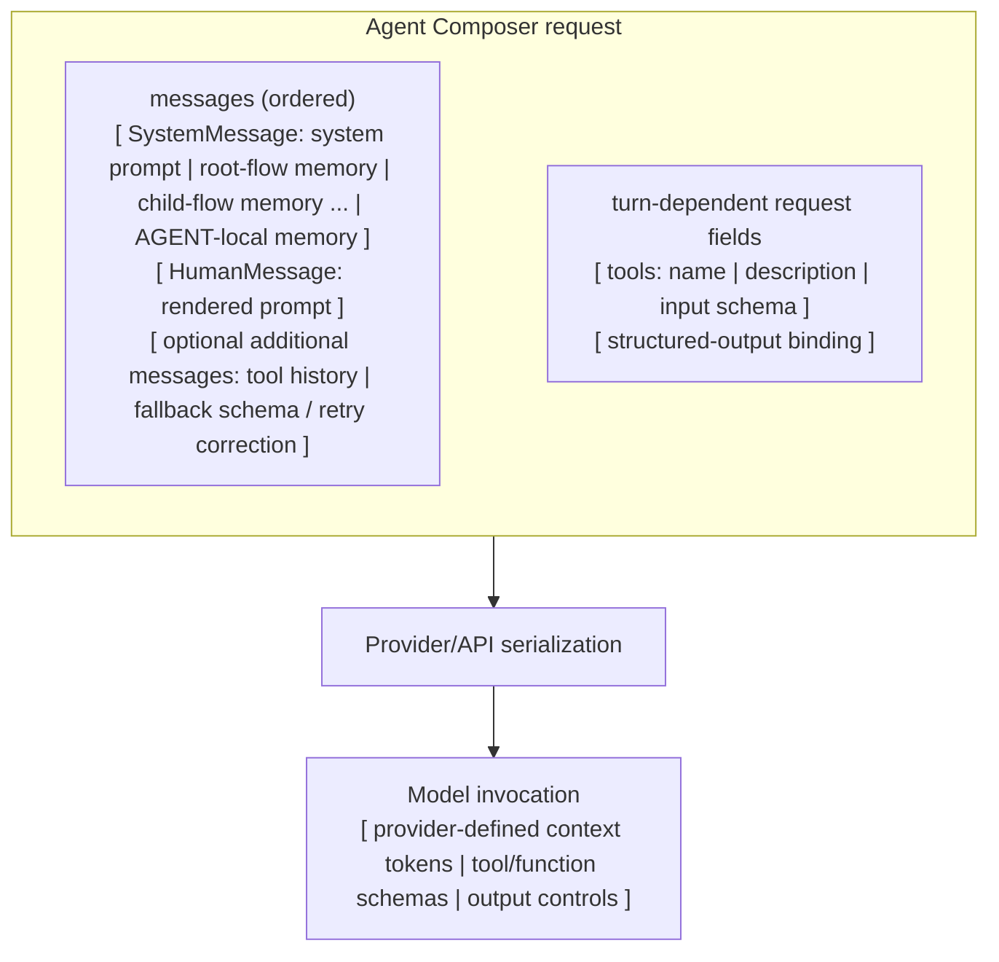

# Agent

In Agent Composer, an **agent** is a composable transformation from a named,
typed input record to an output. A flow exposes an output value, which may be a
scalar, list, record, or `None`. A runtime node exposes a node outcome: a value,
a route, or a request to expand a child flow.

“Agent” is a conceptual umbrella, not one Python class or YAML kind. The
transformation can be represented by one node, a flow of nodes, or a child flow
used inside another flow.

## What an agent is composed of

Every agent has two parts:

1. A **boundary** says what may enter and what must leave. A flow boundary is a
   named, typed `input:` record plus one `output:` value. A node boundary is its
   bound local input record plus one node outcome.
2. **Behavior** performs the transformation behind that boundary.

The shape of the behavior depends on the representation:

| Representation | Shape of its behavior |
| --- | --- |
| Node | One operation, atomic at the graph-state boundary. |
| Flow | A workflow graph whose structure is fixed by the author and whose nodes are connected by data and ordering dependencies. |
| Child flow | A flow graph entered from another flow through CALL, MAP, or LOOP. |

Atomic at the graph-state boundary does not mean “one machine instruction” or
even “one external call.” For example, one AGENT node may make several model and
tool calls before returning. The scheduler still sees one node evaluation with
one outcome. For example, other node kinds provide different atomic behavior:
CODE runs a Python function, TOOL invokes a registered capability, CASE chooses
a route, HUMAN_INPUT asks a person, and WAIT blocks until a deadline.

The concrete **AGENT node** (`kind: agent`) is the LLM-backed atomic behavior.
Its model request deserves a closer look because prompt text, memory, tools, and
the output contract enter that request in different ways.

## Terms

| Term | Meaning |
| --- | --- |
| **Agent** | The conceptual transformation from a named input record to an output. |
| **Node** | One schedulable step in a flow. It receives a bound local input record and returns a node outcome. |
| **AGENT node** | The LLM-backed node kind authored as `kind: agent`. `AgentNode` is its Python class. |
| **Flow** | A graph of nodes packaged behind one input and output boundary. |
| **Root flow** | The flow passed to `run_flow`. |
| **Child flow** | A flow applied inside another by CALL, MAP, or LOOP. “Subflow” is a common synonym; these docs use **child flow**. |
| **Run** | One invocation of a root flow, including its child-flow expansions, under one run log. |

A node outcome is more general than a value: most nodes produce a value, CASE
routes execution, and CALL/MAP/LOOP expand an authored child graph whose terminal
value becomes their output. The engine, not the node, records and applies that
outcome.

## Inside an AGENT node

Agent Composer constructs a structured model request. It does not concatenate
every component into one prompt string:



Every invocation receives the ordered messages. Depending on the mode and turn,
it may also receive tool schemas or a structured-output binding; those fields
are not necessarily present together. The model adapter may encode structured
output as a tool/function schema, JSON mode, or a provider response-schema
feature. When no supported binding is available, Composer instead adds a schema
instruction message.

When a tool-calling AGENT also has structured output, Composer finishes the tool
loop and then performs structured generation against the accumulated messages.

Only `messages` has a Composer-defined sequence. The eventual token or control
representation belongs to the provider, so Agent Composer makes no claim that
tool descriptions occur before or after memory in a flattened token stream.

Every path starts with these messages:

1. The **system message** contains the framework system instruction followed by
   recalled memory sections, ordered from the outermost flow to the local AGENT
   node.
2. The **human message** contains the rendered `prompt:`.

Tool-calling invocations append the model's prior tool calls and corresponding
`ToolMessage` results. Before a structured fallback invocation—which may be the
first model invocation—Composer appends a schema instruction; a retry appends a
correction. In the combined tool/structured path, the tool history is
accumulated before the schema instruction.

### How YAML becomes the request

| YAML or host value | Role in execution |
| --- | --- |
| Node `input:` | Binds the local values available to prompt rendering and memory recall. It is not independently dumped into a message. |
| `prompt:` | Renders local `${name}` values into the initial `HumanMessage`. |
| `memory_policy:` plus host `memory={...}` | Recalls frame text and appends it to the system message as labelled canonical sections. |
| `tools: [name, ...]` | Resolves registered tool schemas and binds them beside the messages in `tool_calling` mode. |
| Structured `output:` | Selects a provider-supported structured-output binding or a fallback schema instruction, then validates the returned value. A bare `str` remains free text. |
| `mode:`, `llm_config:`, `retries:`, `env:` | Controls execution; these values are not additional prompt messages. |

The framework system instruction is fixed today. Authored `system_prompt:` is
tracked in [#259](https://github.com/ngocbh/agent-composer/issues/259).

### Memory is an outer-to-local stack

An AGENT node may see zero or more memory frames:

1. the root flow's frame, if that flow declares `memory_policy:`;
2. one frame for each entered child flow that declares a policy;
3. the AGENT node's local frame, if it declares its own policy.

Only frames that return recalled text contribute a section. Each frame owns and
writes only its own state. MAP items and LOOP iterations reuse the statically
authored frames rather than creating a new frame per occurrence.

```yaml
id: layered_memory
name: layered_memory
memory_policy: reflective
input:
  topic: str

defs:
  research:
    memory_policy:
      name: reflective
      config:
        recall_limit: 8
    input:
      topic: str
    nodes:
      investigate:
        kind: agent
        mode: plain
        memory_policy: reflective
        input:
          topic: ${input.topic}
        output: str
        prompt: "Investigate ${topic}."
    output: ${investigate.output}

nodes:
  run_research:
    kind: call
    call: research
    input:
      topic: ${input.topic}

output: ${run_research.output}
```

For `investigate`, recall is ordered root-flow → child-flow → AGENT-local. The
YAML only names the `reflective` policy; a Python host enables it by passing
`memory={"reflective": implementation}` to `run_flow`. No `${memory}` reference
is required. `learn=True` runs learning after the primary flow terminates, so it
does not change a later node in the same run. New lessons can affect later fresh
runs when the host reuses the same memory implementation or supplies one that
persists its state. See [Injecting agent memory](api.md#injecting-agent-memory)
for the host API.

## Representing agents in YAML

At a full-flow boundary, top-level `input:` declares parameter types and
top-level `output:` binds the returned value. Within the graph, a node's
`input:` binds values from flow inputs or earlier nodes; value-producing AGENT
nodes and CODE nodes use `output:` to declare the value they produce. References such
as `${draft.output}` both move data and define graph edges.

### One node: compact AGENT node

When one AGENT node is enough, compact mode makes the flow and that node share
one definition:

```yaml
id: classify
name: classify
input:
  text: str
output: Literal[positive, neutral, negative]
kind: agent
mode: plain
prompt: |-
  Classify ${text} as positive, neutral, or negative.
  Return exactly one label.
```

Here top-level `input:` is the shared flow/node signature, and `output:` is the
AGENT node's output type re-exported as the flow output.

### Several nodes: a flow

Use a full flow when the transformation needs multiple steps:

```yaml
id: summarize
name: summarize
input:
  article: str
nodes:
  draft:
    kind: agent
    mode: plain
    input:
      article: ${input.article}
    output: str
    prompt: "Summarize this article in one sentence: ${article}"

  count_words:
    kind: code
    input:
      text: ${draft.output}
    output: int
    code: |
      return len(inputs["text"].split())

output:
  summary: ${draft.output}
  word_count: ${count_words.output}
```

The flow itself is the agent at the public boundary. `draft` and `count_words`
are its internal nodes, and their references determine the dependency graph.

### Reuse: a child flow

Put a reusable agent in `defs:` and apply it with a CALL node:

```yaml
id: review_draft
name: review_draft
input:
  draft: str

defs:
  review:
    input:
      text: str
    nodes:
      reviewer:
        kind: agent
        mode: plain
        input:
          text: ${input.text}
        output: str
        prompt: "Review this draft and suggest one improvement: ${text}"
    output: ${reviewer.output}

nodes:
  run_review:
    kind: call
    call: review
    input:
      text: ${input.draft}

output: ${run_review.output}
```

`review` is a child flow with its own boundary and graph. CALL runs it once;
MAP applies a child flow to a list, and LOOP repeatedly applies one while
threading a carried record.

## Planned extensions

The current AGENT surface grants registered tools but has no `skills:` field.
[#260](https://github.com/ngocbh/agent-composer/issues/260) tracks reuse of
Codex/Claude `SKILL.md` packages and host-controlled discovery of project-local
tools. Until those issues are implemented, `system_prompt:` and `skills:` are
not valid Agent Composer YAML.

## The authored structure stays fixed

The author defines the graph. An LLM may generate values and choose among tools
explicitly granted to its AGENT node, but it does not rewrite the flow. Runtime
CALL/MAP/LOOP expansion instantiates child flows already defined by the author.

Nodes are **pure at the graph-state boundary**. A node may call an LLM, run
Python, invoke a tool, wait, or ask a human, but it receives only its bound local
input and capabilities. It cannot mutate the variable pool, scheduler, or graph.
It returns an outcome; the engine records that outcome and updates run state.

Next, read [Architecture](architecture.md) for the path from YAML to a `RunResult`,
or use [Flow syntax](syntax.md) as the complete authoring reference.
