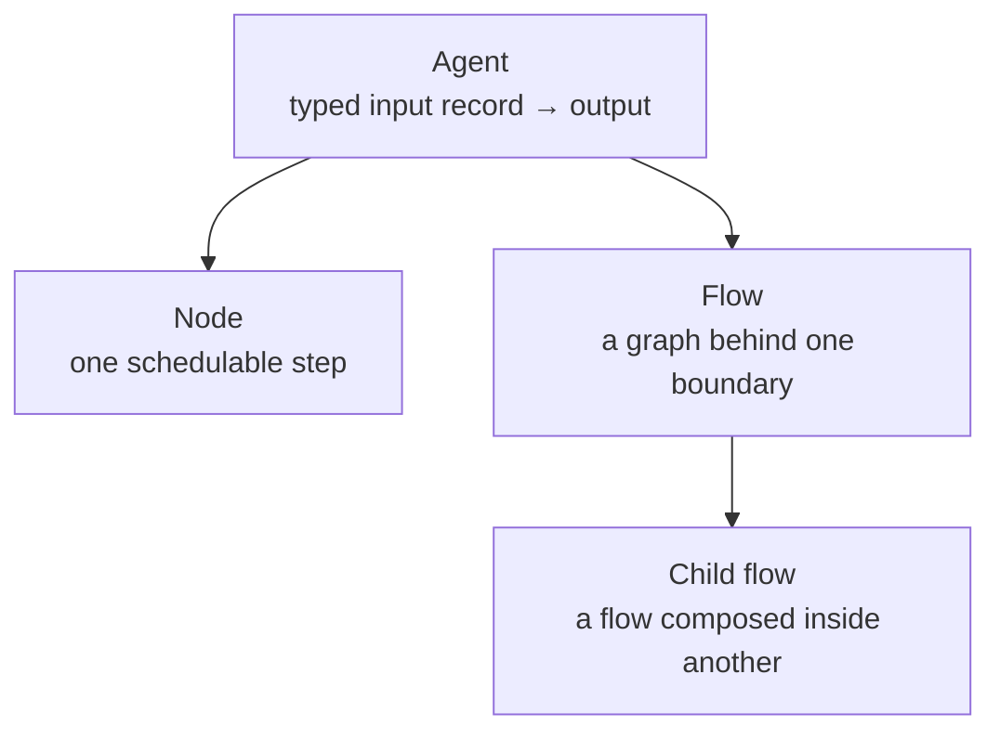

# Agent

In Agent Composer, an **agent** is a composable transformation from a named,
typed input record to an output. A flow exposes an output value, which may be a
scalar, list, record, or `None`. A runtime node exposes a node outcome: a value,
a route, or a request to expand a child flow.

“Agent” is a conceptual umbrella, not one Python class or YAML kind. The
transformation can be represented by one node, a flow of nodes, or a child flow
used inside another flow.



## What an agent contains

Every agent has:

- a **boundary**: named inputs and a declared output or node outcome;
- **behavior**: one node or a graph of nodes that performs the transformation.

Depending on its representation, it may also have:

- task instructions in `prompt:` and model selection in `llm_config:` on an
  AGENT node;
- explicit `tools:` granted to a tool-calling AGENT node;
- a `memory_policy:` on a flow or AGENT node;
- assertions and static execution configuration;
- child agents, represented as child flows.

These capabilities are optional. For example, a CODE node has no task prompt,
and a flow does not need memory. Flow memory is inherited by the AGENT nodes in
that flow; an AGENT node may also have its own memory. This agent memory is
distinct from the engine's typed value store, which carries values between
nodes during a run.

| Capability | YAML representation | Owner |
| --- | --- | --- |
| Task instructions | `prompt:` | AGENT node |
| Model behavior | `mode:`, `llm_config:`, `retries:`, `env:` | AGENT node, with flow-level defaults where supported |
| Tool access | `tools: [name, ...]` | Tool-calling AGENT node; the host registers implementations |
| Memory | `memory_policy:` | Flow or AGENT node; the host injects the named implementation |
| Composition | `nodes:` plus `kind: call`, `kind: map`, or `kind: loop` | Flow or composite node |
| Invariants | `asserts:` and typed `input:` / `output:` | Flow or supported node |

## Terms

| Term | Meaning |
| --- | --- |
| **Agent** | The conceptual transformation from a named input record to an output. |
| **Node** | One schedulable step in a flow. It receives a bound local input record and returns a node outcome. |
| **AGENT node** | The LLM-backed node kind authored as `kind: agent`. `AgentNode` is its Python class. |
| **Flow** | A graph of nodes packaged behind one input and output boundary. |
| **Root flow** | The flow passed to `run_flow`. |
| **Child flow** | A flow applied inside another by CALL, MAP, or LOOP. “Subflow” is a common synonym; these docs use **child flow**. |
| **Run** | One invocation of a root flow, including its child-flow expansions, under one run log. |

A node outcome is more general than a value: most nodes produce a value, CASE
routes execution, and CALL/MAP/LOOP expand an authored child graph whose terminal
value becomes their output. The engine, not the node, records and applies that
outcome.

## Representing agents in YAML

At a full-flow boundary, top-level `input:` declares parameter types and
top-level `output:` binds the returned value. Within the graph, a node's
`input:` binds values from flow inputs or earlier nodes; value-producing AGENT
and CODE nodes use `output:` to declare the value they produce. References such
as `${draft.output}` both move data and define graph edges.

### One node: compact AGENT

When one LLM call is enough, compact mode makes the flow and its single AGENT
node share one definition:

```yaml
id: classify
name: classify
input:
  text: str
output: Literal[positive, neutral, negative]
kind: agent
mode: plain
prompt: |-
  Classify ${text} as positive, neutral, or negative.
  Return exactly one label.
```

Here top-level `input:` is the shared flow/node signature, and `output:` is the
AGENT node's output type re-exported as the flow output.

### Several nodes: a flow

Use a full flow when the transformation needs multiple steps:

```yaml
id: summarize
name: summarize
input:
  article: str
nodes:
  draft:
    kind: agent
    mode: plain
    input:
      article: ${input.article}
    output: str
    prompt: "Summarize this article in one sentence: ${article}"

  count_words:
    kind: code
    input:
      text: ${draft.output}
    output: int
    code: |
      return len(inputs["text"].split())

output:
  summary: ${draft.output}
  word_count: ${count_words.output}
```

The flow itself is the agent at the public boundary. `draft` and `count_words`
are its internal nodes, and their references determine the dependency graph.

### Reuse: a child flow

Put a reusable agent in `defs:` and apply it with a CALL node:

```yaml
id: review_draft
name: review_draft
input:
  draft: str

defs:
  review:
    input:
      text: str
    nodes:
      reviewer:
        kind: agent
        mode: plain
        input:
          text: ${input.text}
        output: str
        prompt: "Review this draft and suggest one improvement: ${text}"
    output: ${reviewer.output}

nodes:
  run_review:
    kind: call
    call: review
    input:
      text: ${input.draft}

output: ${run_review.output}
```

`review` is a child flow with its own boundary and graph. CALL runs it once;
MAP applies a child flow to a list, and LOOP repeatedly applies one while
threading a carried record.

## The authored structure stays fixed

The author defines the graph. An LLM may generate values and choose among tools
explicitly granted to its AGENT node, but it does not rewrite the flow. Runtime
CALL/MAP/LOOP expansion instantiates child flows already defined by the author.

Nodes are **pure at the graph-state boundary**. A node may call an LLM, run
Python, invoke a tool, wait, or ask a human, but it receives only its bound local
input and capabilities. It cannot mutate the variable pool, scheduler, or graph.
It returns an outcome; the engine records that outcome and updates run state.

Next, read [Architecture](architecture.md) for the path from YAML to a `RunResult`,
or use [Flow syntax](syntax.md) as the complete authoring reference.
