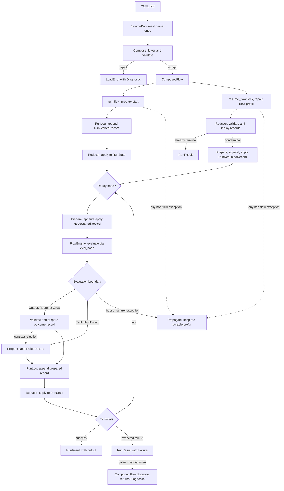
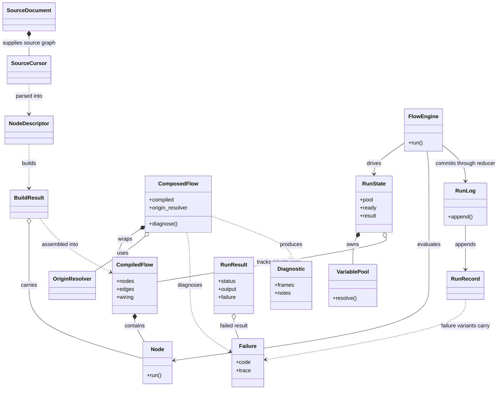
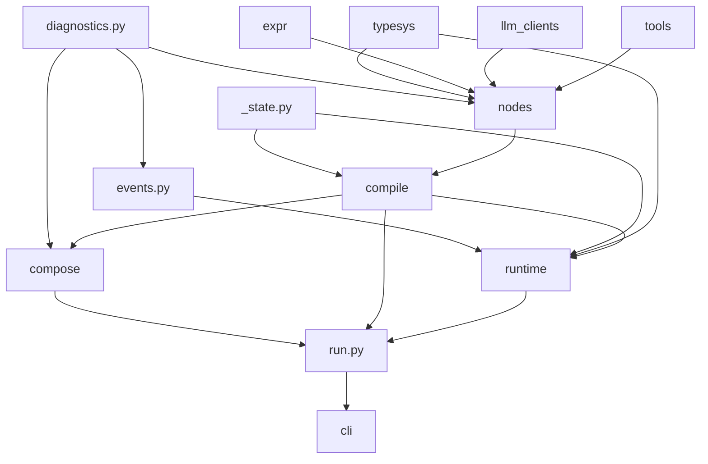

# Architecture — from a YAML file to a running flow

> A map for contributors. If [Home](index.md) tells you *why* Agent Composer looks
> the way it does, this page tells you *how* it works end to end — the journey one
> `flow.yaml` takes to become a result. The final links lead to deeper pages.

## The 10-second model

There are two big moves. A durable run adds one authoritative history beside the
interpreter:

```
   flow.yaml  ──load──▶  ComposedFlow  ──run──▶  RunResult
   (text)               (a typed graph)       (output | failure)
                              │
                              └── execute through an append-only RunLog
```

- **Load** is a *compiler*. It reads the text once, checks it, and lowers it to a
  frozen, typed graph. All the YAML-awareness lives here and nowhere else.
- **Run** is an *interpreter*. It walks a private copy of that graph, handing each
  box its inputs and collecting what it returns, until it derives a terminal.
- **The run log is authority.** Every state transition is appended before the
  reducer applies it. A process-local run uses the same protocol in memory; a
  recoverable run writes canonical JSONL records with fsync.

```python
from pathlib import Path

from agent_composer import load_flow, run_flow

path = Path("flow.yaml")
loaded = load_flow(                               # text  -> ComposedFlow
    path.read_text(), source_label=path.name
)
result = run_flow(loaded, {"question": "..."})    # graph -> RunResult
print(result.output)
```

Those two functions are the ordinary public seam between the two halves of the
codebase. `resume_flow()` in `agent_composer.run` re-enters the run half from an
existing durable log.

The complete control path keeps source presentation at the Compose boundary and
state authority at the run-log boundary:



Only an expected evaluation or outcome-contract rejection becomes a
`NodeFailedRecord`. Host, control, log, and invariant exceptions propagate; they
are never translated into a semantic failure record and may leave only the
durable prefix committed before the exception.

## The core objects at a glance

The loader deliberately uses different carriers from the engine. Build-time
validation ranges stop at `BuildResult`; opaque origins are the only source
identity that can cross into `CompiledFlow` or runtime semantics. The
presentation-only resolver on `ComposedFlow` separately retains source
occurrences so it can materialize diagnostic frames later.

| Type or contract | One responsibility |
|------------------|--------------------|
| `SourceDocument` | Safely constructs one physical YAML document once and privately owns its definition graph. |
| `SourceCursor` | Provides occurrence-aware navigation, values, and ranges over that document or a source-free projection. |
| `NodeDescriptor` | Holds one kind-specific, validated parse product and its Compose-owned source metadata. |
| `BuildResult` | Carries one built `Node`, its wiring and edges, and transient ranges used only by Compose validators. |
| `ComposedFlow` | Wraps the `CompiledFlow` with flow metadata and the optional origin resolver used by `diagnose()`. |
| `OriginResolver` | Resolves an opaque `OriginRef` to one presentation frame without entering runtime semantics. |
| `CompiledFlow` | Owns semantic nodes, edges, wiring, outputs, and static model configuration, but no mutable run state or YAML ranges. |
| `Node` | Owns kind-specific execution and produces `Output`, `Route`, or `Grow` without writing the shared pool. |
| `VariablePool` | Stores typed node and system values, resolves `${...}` reads, and round-trips losslessly for replay. |
| `RunRecord` | Is the closed union of durable initialization, resume, node-start, outcome, growth, and failure transitions. |
| `NodeFailedRecord` | Carries exactly one canonical `Failure` as the durable expected-failure transition. |
| `RunLog` | Defines the append-only authoritative sequence of `RunRecord` values. |
| `MemoryRunLog` | Provides the same canonical record authority for a process-local run. |
| `JsonlRunLog` | Provides the locked, fsynced canonical JSONL authority used for recovery. |
| `RunState` | Holds reducer-derived state for one private graph copy, including the pool, frontier, and terminal result. |
| `FlowEngine` | Dispatches ready nodes and commits transitions as the kind-blind, single state writer. |
| `Failure` | Carries a source-neutral semantic run failure and its opaque origin trace. |
| `Diagnostic` | Carries resolved, presentation-only frames and notes for a load or run failure. |
| `RunResult` | Returns the public terminal success or failure for one fresh or recovered invocation. |

The relationships are intentionally curated: they show the ownership boundaries,
not every helper or field in the implementation.



---

## Phase 1 — Load: text becomes a typed graph

`load_flow()` (in `compose/loader.py`) is the front door. It runs a fixed pipeline of
small passes, each one taking the output of the last. Think of it as a compiler's
stages: **parse → desugar → wire → check → freeze.**

```
 text
  │  SourceDocument.parse  YAML text -> one safe construction + private definition graph
  │  SourceCursor          document  -> occurrence-aware section and node views
  │  parse_file            document  -> the strict top-level ComposeFile
  │  parse_nodes           cursor    -> one frozen *descriptor* per node (kind-specific)
  │  desugar_*             rewrite sugar into core nodes:
  │                          inline call(...) directives, adaptive questions, case targets
  │  build (per kind)      each descriptor -> a runtime Node  (+ its flow-owned wiring;
  │                          a case lowers in its own build, emitting its branch edges)
  │  infer_data_edges      read every ${...} -> draw the edges NOBODY drew by hand
  │                          (+ append each case's own data+control edges)
  │  validate_references   every ${...} points at something real & type-compatible
  │  reject_cycles         the static graph must be a DAG
  │  check_case_handles    every branch has a home
  ▼
 CompiledFlow  (wrapped with parameters + exact origin resolver as a ComposedFlow)
```

Two ideas make this phase tractable:

**Edges are inferred, never authored.** You write `input: {brief: ${frame.output}}`;
`infer_data_edges` reads that reference and adds the `frame → this` edge. The graph is
a *consequence* of the data references, so it can never disagree with them.

**The front end is split on two axes.** Per-node-kind logic lives in
`compose/nodes/<kind>.py` — each kind module owns its descriptor, its `parse()`, and
its `build()`. Cross-node graph passes live in the ordered phase packages
`compose/parse/ → compose/desugar/ → compose/edges/ → compose/validate/ →
compose/build/`. The engine core sees none of it.

The output is a **`ComposedFlow`**: a `CompiledFlow` (the static topology) plus the
canonical typed `input:` parameter view and an optional complete `origin_resolver`.
The semantic `CompiledFlow` carries no source-text or range snapshot. Source-free
graphs use `None`; every Compose-owned origin reachable from an originful graph has
one exact diagnostic-frame route.
`ComposedFlow.diagnose(failure)` is the authoring-front-end boundary that resolves
the complete trace through that authority into presentation-only `Diagnostic` data.

The loader owns one `SourceDocument` for each flow source document. Source-aware parsing
and inline extraction reuse cursors into it; descriptors retain derived ranges and copy
node/field locations to Compose-owned `BuildResult` values for validation. Semantic nodes
receive only opaque origins, never YAML ranges. Physical cursors retain definition ranges and occurrence paths;
this distinguishes two alias or flattened-merge occurrences even when they share the
same anchored value definition. Virtual cursors represent generated, location-free
values, while projected cursors rewrite a view and retain explicitly aligned authored
children. Documents keep the parser graph private, projections snapshot their values,
and public value reads are defensive copies. No phase reparses YAML to recover source.

For external `uses:` files, the shared load context caches each successful
`ComposedFlow` by resolved absolute path. Repeated aliases and diamond dependencies thus
read, parse, and compile that physical file once during the load graph. Only successfully
compiled flows with complete resolvers enter the cache. A file-local alias cache holds
rebased graph copies: repeated calls through one alias reuse its copy, while different
aliases and diamond branches get disjoint lexical origin namespaces without changing the
canonical path-cache entry.

→ **[compose.md](compose.md)** is the full tour of this phase: the pipeline pass by
pass, the two-axis layout, descriptors vs. nodes, and how a `${...}` becomes an edge.

---

## Phase 2 — Run: records drive the interpreter

`run_flow()` (in package-root `run.py`) makes a private graph copy, resolves the
run's inputs and model configuration, creates a `RunState` plus `RunLog`, and
commits the first `RunStartedRecord`. It then lends the matching state/log pair to
the **`FlowEngine`** (`runtime/engine.py`).

The engine is a single-writer dispatcher. In serial mode it evaluates ready nodes
itself; in pooled mode workers evaluate only and return raw outcomes to the
dispatcher. For every transition, runtime follows the same order:

```
prepare + validate ──▶ append record ──▶ apply reducer ──▶ publish observers
```

The append is the authority boundary. If it fails, the reducer does not apply the
transition and no matching success/failure observer is published. The dispatcher
is the sole ready-queue consumer and state writer, so worker completion order can
never create concurrent state mutation.

A node is a **pure function of its inputs**. It receives a plain record and returns
one of three outcomes — it never touches the variable pool:

| Outcome | Meaning |
|---------|---------|
| `Output` | one typed value for the engine to bind and propagate |
| `Route`  | a `case` decision — take this branch and skip the siblings |
| `Grow`   | a canonical seed for one deterministic `call`/`map`/`loop` expansion |

Failure is a `raise`, captured at the evaluation boundary and reduced through a
`NodeFailedRecord`; it is not a fourth node outcome. A `Grow` seed is interpreted
by the compile-owned `build_grow` callable injected at the package-root boundary,
then recorded with a topology digest before the reducer splices the fragment.

The engine's defining rule is that **it never asks what kind of node this is.** It
branches only on the outcome sum and node-owned traits (`is_spawner`,
`binds_per_item`, and so on). Adding a node kind requires no engine branch — a
ratchet test (`tests/engine/test_kind_census.py`) keeps the core's kind-dispatch
count pinned at 0.

Authorable blocking interaction stays within one live evaluation. `human_input`
and an agent's `ask_user` tool wait for the host, while WAIT occupies a worker
until its absolute UTC deadline. Each eventually returns `Output` from that same
node invocation.

→ **[engine.md](engine.md)** covers the scheduler, reducer, run log, recovery, and
growth. **[nodes.md](nodes.md)** covers the node contract and each kind's
`forward`.

---

## Recovery is deterministic prefix replay

Supplying `log=<path>` to `run_flow()` selects `JsonlRunLog`. It exclusively
creates the path, holds a nonblocking exclusive advisory lock for the run, writes
one canonical record per line, and fsyncs every append. The initial record retains
the run identity, flow fingerprint, complete typed pool, worker count, and resolved
LLM configuration. Later records retain starts and canonical outcomes, including
growth seeds and digests.

`resume_flow(flow, log=path)` acquires the same lock before reading. It removes an
incomplete final line, validates the contiguous prefix, verifies the supplied
flow's fingerprint, and folds every historical record through the same reducer
used live. Replay itself publishes no observers.

- A terminal prefix is returned without changing the file.
- A nonterminal prefix gets one `RunResumedRecord`; its ordered unfinished starts
  are retried before the existing ready frontier, then normal dispatch continues.
- Current environment model defaults and fresh inputs cannot alter recovery; the
  initialization record is the source of truth.

This is state recovery, not exactly-once execution of arbitrary external effects.
A node with a durable start and no durable outcome is retried, so effectful leaf
code must tolerate that boundary.

---

## The stuff that flows through the pipes

Two subsystems are used by both phases, so they sit underneath:

- **Typed values & the pool** — every input, output, and stored value is a typed,
  losslessly serializable `TypedValue`; the engine's memory is a `VariablePool` of
  them. The record codec carries those values through a canonical JSON form, so
  live reduction and prefix replay see the same data.
  → **[typing.md](typing.md)**
- **The `${...}` grammar** — one small expression language: parse to an AST, then
  either *evaluate* it against the pool (at run time) or *ref-walk* it to find its
  dependencies (at load time, to infer edges). One grammar, two readers.
  → **[expressions.md](expressions.md)**

---

## Four properties, and where they come from

Everything in the codebase is in service of four guarantees — each is a
*consequence* of a design choice above, not a feature bolted on:

| Property | Falls out of… |
|----------|---------------|
| **Structurally reproducible** — same authored control/data graph | the author fixes the graph; the LLM only fills leaf boxes |
| **Durably recoverable** — replay one validated transition prefix | append-before-apply records + typed canonical state |
| **Extensible** — new kinds don't touch the core | the kind-blind engine + per-kind front-end modules |
| **Readable / debuggable** | the flow *is* the plan; source ranges point errors back at the YAML |

---

## Where the code lives

The main packages form an acyclic dependency ladder — each layer imports only
from those below it. Arrows below point from a lower-level owner to a principal
consumer; they are a dependency map, not an exhaustive import graph.



`diagnostics` owns source ranges, opaque origins, and the resolution seam;
`events` owns transient observer values; `nodes` owns the pure node contract and
each kind; `compile` owns compiled IR, validation, and growth construction; and
`compose` is the only YAML front end.

`_state.py` is a shared scheduler-state leaf. `runtime/` owns the append-only log,
reducer-owned `RunState`, kind-blind engine, and worker pool; it consumes compiled
topology but never imports `compile.expand`. Package-root `run.py` sits above
`compose`, `compile.expand`, and `runtime`: it owns log creation/recovery and
injects `build_grow`. `llm_clients/` contains lazy provider adapters, `tools/`
contains the tool registry and host interaction seam, and `cli/` owns terminal
presentation.

The package facade exposes its existing public API lazily. Importing
`agent_composer.diagnostics` therefore loads no YAML, compose, node, compile, or
runtime module merely as a side effect of package initialization.

The rules that keep the picture honest: **never add a back-edge**, and **never
teach `runtime/` about a `NodeKind`**.

---

## Where to go next

<div class="grid cards" markdown>

- :material-cog: **[compose.md](compose.md)** — Phase 1 in depth: how YAML is lowered to a `CompiledFlow`.
- :material-play: **[engine.md](engine.md)** — Phase 2 in depth: records, reducer, scheduler, and recovery.
- :material-cube: **[nodes.md](nodes.md)** — every node kind and what its `forward` returns.
- :material-shape: **[typing.md](typing.md)** — the typed value system and the variable pool.
- :material-code-braces: **[expressions.md](expressions.md)** — the `${...}` grammar.

</div>
