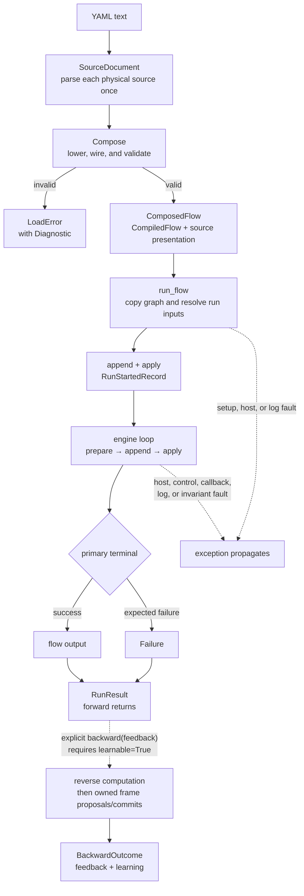
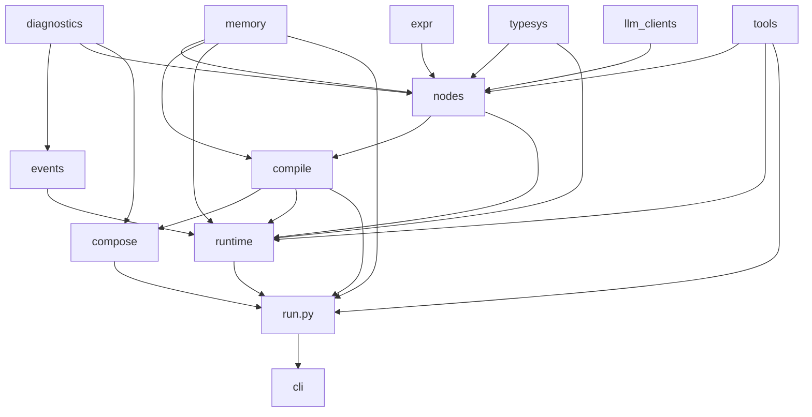

# Architecture — from YAML to `RunResult`

> [Agent](agent.md) defines the framework's conceptual model. This page follows
> one authored agent from YAML text, through compilation and execution, to its
> public result. The linked pages own the implementation details.

## The lifecycle in one picture

Agent Composer has two main phases: **Compose** builds a reusable program, then
the **engine** runs a private instance of that program. One append-only run log
is the authority for every runtime state change.
After forward returns, the caller may explicitly start backward on a retained run.



The ordinary API follows the same boundary:

```python
from pathlib import Path

from agent_composer import load_flow, run_flow

path = Path("flow.yaml")
flow = load_flow(path.read_text(), source_label=path.name)
result = run_flow(
    flow,
    {"question": "What changed?"},
    llm_config={"provider": "ollama", "model": "llama3.2:3b"},
)
```

`load_flow()` returns a `ComposedFlow`; `run_flow()` returns a `RunResult` when
the authored flow succeeds or reaches an expected semantic failure. Faults in
the host or runtime infrastructure raise instead of masquerading as a failed
flow. The `ComposedFlow` passed to `run_flow()` is the **root flow** for that
run.

## 1. Compose builds the reusable program

`compose/` is the only package that understands YAML. For each physical source,
it constructs one `SourceDocument`; cursors and later passes reuse that
construction instead of reparsing text to recover values or locations. A shared
load context also caches successfully compiled external `uses:` files by
resolved path.

Compose then lowers authoring conveniences, builds nodes, infers data edges from
`${...}` references, validates contracts and the DAG, and synthesizes the flow
boundary. The result separates two responsibilities:

- **`CompiledFlow`** is the source-neutral semantic program: nodes, edges,
  wiring, typed boundaries, outputs, and static configuration. It contains no
  mutable run state or YAML ranges.
- **`ComposedFlow`** is the public loaded value. It wraps the `CompiledFlow`
  with author-facing metadata and an optional resolver that can turn opaque
  failure origins into source frames.

Invalid source raises `LoadError(Diagnostic)` before a run exists. See
[Compose](compose.md) for the passes and provenance model, and
[Flow syntax](syntax.md) for the authoring surface.

## 2. The run boundary creates one private execution

`run_flow()` leaves the reusable `CompiledFlow` untouched. It fingerprints the
authored program, copies it, coerces supplied caller input, resolves model
configuration, and optionally opens host-injected memory sessions. It creates:

- a **private graph**, which dynamic child flow expansion may change;
- a **variable pool**, the typed value store for inputs and node outputs;
- a **`RunState`**, containing the graph's frontier and reducer-derived state;
- a **`RunLog`**, either process-local or durable JSONL.

The variable pool is runtime graph state, not agent memory. Agent memory is an
optional host capability configured by authored `long_term_memory` declarations.
Each declaration selects a policy name resolved through `run_flow(memory=...)`.

Initialization becomes real only when its complete `RunStartedRecord` is
appended and applied. That record fixes the run identity, initial typed values,
flow fingerprint, worker count, resolved model configuration, and any memory
snapshot needed for recovery.

CALL, MAP, and LOOP apply a [child flow](agent.md)
by expanding it into this same private graph. The expansion does not create a
child engine, child variable pool, or child run log; the entire root flow is one
run.

## 3. Records drive the engine

The engine is a kind-blind dispatcher. It chooses ready nodes, binds their
inputs from the variable pool, and evaluates them through the common node
contract. A node is pure at the graph-state boundary: it may call an LLM, tool,
human, or clock, but it cannot mutate the graph, scheduler, or variable pool.

For every transition, runtime preserves one order:

```text
prepare and validate → append record → apply reducer → publish observers
```

The append is the authority boundary. If it fails, the reducer does not apply
the transition and observers do not announce it. The reducer is the only writer
of `RunState`, in both serial and pooled execution.

A node returns one of three outcomes:

| Node outcome | Runtime meaning |
| --- | --- |
| `Output` | Validate and bind one value. |
| `Route` | Select a CASE branch without binding a value. |
| `Grow` | Validate and splice a deterministic child flow expansion. |

Failure is not a fourth outcome. An expected evaluation or result-contract
rejection is prepared as a `NodeFailedRecord`; reduction derives the primary
failed terminal from the recorded `Failure`. The [Runtime nodes page](nodes.md)
owns the node contract, while [The engine](engine.md) owns scheduling, records,
growth, and reduction.

## 4. Primary result, learning, and faults stay distinct

Primary execution ends in exactly one of two semantic states:

| State | Public projection |
| --- | --- |
| Success | `RunResult(status="succeeded", output=..., failure=None)` |
| Expected flow failure | `RunResult(status="failed", output=None, failure=Failure(...))` |

For a Compose-authored flow, `ComposedFlow.diagnose(result.failure)` resolves the
failure's opaque origin trace into a presentation-only `Diagnostic` without
putting YAML coordinates into runtime semantics.

`learnable=True` retains accepted execution for a later explicit
`RunResult.backward(feedback)` call, independently of memory recall. Forward
returns before any learner or commit. Backward uses the same record authority and
returns a separate `BackwardOutcome`, observed through `backward_outcome` and its
`learning` projection. It never changes the primary output, `Failure`, or events.
All backward results and owned frame proposals precede Ready and any policy
commit. Every explicit `backward()` call starts a new whole attempt, whatever
earlier attempts did; terminal recovery never starts one by itself.

Host setup errors, observer/stream callback failures, log I/O errors, control interruption, and
internal invariant violations propagate as exceptions after owned resources are
drained and closed. They do not become `RunResult(status="failed")`. A durable
log may still contain the valid prefix committed before such a fault. See the
[Python API](api.md) for the full result and memory surfaces.

## Recovery replays the same authority

Passing `log=<new-path>` selects a locked `JsonlRunLog`; every append is encoded
canonically and fsynced. `resume_flow(flow, log=path)` then:

1. locks the existing log and removes an incomplete final line;
2. validates its contiguous records and the supplied flow fingerprint;
3. rebuilds a private graph and folds the prefix through the same reducer used
   during live execution;
4. after any incomplete-tail repair, returns a terminal forward result without
   appending records, or continues unfinished forward execution when eligible
   for retry.

If primary execution is unfinished and eligible, recovery appends one `RunResumedRecord`,
retries nodes that have a durable start but no durable outcome, and continues
the recorded frontier. If the primary result is terminal, recovery only inspects
its accepted backward prefix and opens no memory sessions. Inputs, run identity,
resolved model configuration, dynamic growth, and memory snapshots come from
the log rather than current defaults.

Historical conversation metadata does not block ordinary retry. Conversation
history belongs to the memory backend; runtime does not reconstruct it from the
run log or claim to resume an external request midway through. See the
[Python API recovery contract](api.md#durable-recovery-with-resume_flow).

Replay makes engine state deterministic; it cannot make arbitrary external
effects exactly once. An interrupted node can run again, so effectful node
implementations must tolerate that recovery boundary.

## Ownership boundaries

The main carriers deliberately do not collapse into one all-purpose graph
object:

| Boundary | Owner | What crosses it |
| --- | --- | --- |
| Source presentation | `compose/` | `SourceDocument`, source cursors, load diagnostics, and an optional origin resolver |
| Semantic program | `compile/` | `CompiledFlow` plus opaque origins; no YAML ranges or mutable run state |
| Node execution | `nodes/` | Plain bound inputs and one `Output`, `Route`, or `Grow`; no shared-state access |
| Run setup and delayed backward | `run.py` | Private graph/data, injected policy references, guarded log/resource lifetime, and `RunResult` |
| Runtime authority | `runtime/` | `RunRecord` sequence reduced into `RunState`; no YAML parsing or node-kind dispatch |
| Backward computation | `nodes/` + `runtime/` | Recorded node context and three result channels; shared pure transfer/context validation below drivers |
| Typed graph state | `typesys/` | Losslessly serializable values and the variable pool |
| Agent memory | `memory/` + host | Source-neutral policy protocols and host-owned implementations; separate from the variable pool |

This separation keeps source presentation optional, compiled programs reusable,
runtime recovery record-authoritative, and the engine independent of node kinds.

## Package dependency map

The package graph is acyclic. Arrows point from a lower-level owner to a
principal consumer; this is a boundary map, not every import.



Two rules guard the center of the design: do not add a dependency back-edge,
and do not teach `runtime/` about `NodeKind`. Package-root `run.py` sits above
Compose, Compile, and Runtime so it can inject the kind-aware growth builder
without reversing those dependencies.

## Read deeper

<div class="grid cards" markdown>

- :material-cog: **[Compose](compose.md)** — parsing, lowering, validation, and source provenance.
- :material-play: **[The engine](engine.md)** — scheduling, records, reduction, failure, growth, and recovery.
- :material-cube: **[Runtime nodes](nodes.md)** — `Node`, the common run template, and node outcomes.
- :material-shape: **[Types](typing.md)** — typed values and the variable pool.
- :material-memory: **[Python API](api.md)** — run configuration, memory injection, learning, diagnosis, and recovery.

</div>
