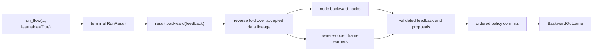

# Learning from feedback

A **learnable run** retains the accepted execution needed to examine a finished
flow and learn from feedback later. It does not retrain a model, rewrite the
authored graph, or change values during forward execution. The application decides
whether to enable retention and when to submit feedback.



Forward and backward have separate results. `RunResult.status`, `output`,
`failure`, and `events` describe forward execution and never change when the
application calls `backward()`. The returned `BackwardOutcome` describes that
explicit attempt; `RunResult.backward_outcome` exposes the latest observed one,
and `RunResult.learning` is its learning projection.

## Retention and memory are separate

`learnable=True` makes a run learnable. It retains accepted inputs, outputs, selected
data routes, and invocation context so a later reverse pass can attribute
feedback. It does **not** require a memory backend, and it does not call a learner
during forward execution.

`memory=` is separate host-provided infrastructure for recall and durable policy
updates. An authored `long_term_memory` declaration chooses a policy name; the
host supplies its implementation under that name. Recall and optional session
history can be enabled without `learnable=True`, and a learnable run can operate
without any memory policy.

`composer run` acts as a host for declared built-in policies automatically. Its
`--memory-storage POLICY=PATH` option enables persistence for selected policies;
others remain process-local. It does not enable learning or call `backward()`.
Session history still advances during forward, while saving episodic or reflective
learning requires the explicit Python API. See
[CLI memory](cli.md#memory-policies-and-storage).

| Setting | What it enables | What forward execution does |
| --- | --- | --- |
| `learnable=True` | Retained execution and a later `backward()` call | Records accepted facts; does not learn or commit |
| `memory={...}` | Recall and optional session history for declared frames | Opens policy snapshots, recalls context, and advances enabled session history |
| Both | Feedback-informed frame learning plus forward memory capabilities | Retains execution and uses memory; does not run learners or commit learned mutations |

This separation lets an application collect evaluator feedback without a memory
backend, or use recalled context in an ordinary non-learnable run.
[`SessionMemory`](api.md#sessionmemory-foundation) saves actual API conversation
exchanges automatically during forward. These history updates are not learning.
Explicit API backward self-feedback can become committed notes for future calls
through the existing memory lifecycle, without another model call. No-feedback
backward adds no session notes; raw conversation history stays unchanged.
API context summaries are separate from learning: forward execution may summarize
older turns with the current model while preserving raw history and recent whole
turns. The history budget does not include learned-note recall.

## Start an explicit backward attempt

Call `backward()` only after the forward run is terminal. Feedback may be a string,
a partial record matching the output shape, an exact-length positional list, or
`None`. A string addresses the whole output; omitted record fields and `None`
positions contribute no feedback. Every list must match the recorded list length at
every depth. A failed forward result accepts only a string or `None` because it has
no successful output shape.

```python
from agent_composer import run_flow

result = run_flow(flow, {"topic": "routing"}, learnable=True)
forward_output = result.output

outcome = result.backward({
    "summary": "Too long.",
    "tags": [None, "This tag is irrelevant."],
})

assert outcome.status == "succeeded"
assert result.output == forward_output
```

Invalid feedback is rejected before the attempt opens a memory session or records
an attempt. An empty string is still feedback. Calling `backward()` with no
external feedback skips AGENT model work when nothing reaches an AGENT, while
enabled memory frames can still learn from their accepted history.

For the complete public call and exact feedback examples, see
[explicit backward feedback](api.md#explicit-backward-feedback).

## How feedback travels

The reverse pass walks the **accepted data lineage**, not scheduling or control
edges. It therefore follows the branch that CASE actually selected, preserves
separate MAP and LOOP occurrences, and delivers an ordered tuple when several
downstream messages reach the same occurrence. A list remains one structured
message inside that tuple; the runtime does not merge independently supplied
feedback into new prose.

START, END, and structural child-flow boundaries transfer feedback mechanically.
Compositional expression operations preserve paths through projections, records,
lists, concatenation, and repetition. Opaque expression functions stop feedback:
the runtime cannot safely infer which input field caused a custom function's
output.

Each reached behavioral occurrence receives its retained `BackwardContext` and
ordered feedback tuple. Its `backward()` hook returns three channels:

| Channel | Destination |
| --- | --- |
| `input_feedback` | Declared input names, routed upstream through retained selected-data routes |
| `self_feedback` | The occurrence's own learning context |
| `variable_feedback` | The occurrence's declared local variables, retained as advice only |

The base hook returns empty channels and stops transfer. An AGENT can make one
tool-free model call from its accepted rendered prompt, locals, evidence, and
effective model configuration. No prompt rendering, recall, tool execution,
forward node, or expression function runs again. Variable feedback does not
update variables or rewrite the graph.

See [runtime nodes](nodes.md#the-contract) for the hook contract and
[the engine](engine.md#explicit-backward-attempts) for the reverse-fold rules.

## What memory may learn

Memory belongs to the flow or AGENT frame that declared it. A node or child flow
may contribute feedback and history to an ancestor frame, but it cannot mutate
that inherited frame. Only the receiving frame's learner can propose mutations
for its own memory.

After the reverse fold, every enabled frame receives an owner-scoped
`LearnContext` in recorded layout order. This includes frames with empty feedback,
empty history, or no reached occurrence. The policy decides whether execution
history, feedback, or both justify a proposal. For example, a history database
can append a record while a reflective policy can propose a lesson.

The engine stays policy-neutral. It supplies the retained context, validates the
proposal, and later invokes the policy's existing commit interface; it does not
invent lessons or perform backend-specific writes. See
[injecting agent memory](api.md#injecting-agent-memory) for the host-side policy
interfaces and [AGENT memory](agent.md#memory-is-an-outer-to-local-stack) for
recall order.

## Episodic memory

`EpisodicMemory` is the built-in deterministic history policy. Import it from
`agent_composer.memory.episodic` and inject it under the authored `episodic`
name. It proposes one append mutation for every owner-scoped `MemoryEpisode` it
receives, including executions without external feedback. Nothing is appended
during forward execution: `learnable=True` retains the episode, and a successful
later `backward()` attempt commits it.

Each static frame has two positive integer settings. `max_episodes` bounds the
stored history and evicts its oldest entries after a commit. `recall_limit`
bounds contextual AGENT recall. Contextual recall uses deterministic lexical
overlap and recency; context-free recall returns the complete bounded history in
chronological order. Entries are canonical JSON and preserve the run ID,
occurrence, owner path, inputs, outcome or failure, prompts, recalled sections,
visible model/tool interactions, and accepted execution sequence.

By default the backend lives only in the current process. Reusing one instance shares
committed episodes with later fresh runs; `reset()` clears them. Run sessions pin
an immutable snapshot, so recall remains stable while another session commits.
Recorded JSON snapshots can restore a pristine instance for recovery.

The episodic, reflective, and session backends support optional
`storage="./memory.sqlite"` on their constructors. Episodic episodes, reflective
lessons, and session history/notes then survive restarts, along with private
commit deduplication. A file has one owning backend until explicit close or
context exit. Idle run handles allow close;
active operations and queued turns do not. Storage does not trigger learning:
episodes and lessons still require explicit backward, while session conversations
advance automatically during forward execution. See
[durable memory](api.md#optional-durable-memory) for the complete lifetime and
recovery contract.

## Profile memory

`ProfileMemory` keeps one markdown document per instance, for example one per
person. Import it from `agent_composer.memory.profile`, give it a store, and
inject it under the policy name your flows declare:

```python
from agent_composer.memory.profile import ProfileMemory
from agent_composer.memory.profile_store import FileProfileStore

profile = ProfileMemory(FileProfileStore("people/ada.md"))
result = run_flow(flow, inputs, memory={"profile": profile}, learnable=True)
```

- **Recall.** A run pins the version that is current when it starts. Every AGENT
  under the outermost frame that declares the policy sees the whole document,
  even while someone edits it. Nested frames of the same policy add nothing, and
  two unrelated top-level frames are a setup error. Frame config is empty.
- **Learning.** `backward(feedback)` makes one tool-free model call. It sends the
  current document, the version the run saw when it differs, the feedback, and
  recent AGENT episodes within `input_budget_chars` (default 24,000). The newest
  episode is always sent; if it alone is over the budget, it is cut to a prefix
  and a suffix. Older episodes are added whole while they fit. Each episode
  includes its visible model replies, tool calls, and tool results. The
  reply must be the whole document inside `<profile>` tags and at most
  `max_chars` (default 32,000, about 8k tokens). No feedback, or an unchanged
  document, proposes nothing. `llm_config=None` uses the ambient model defaults.
- **Commit.** A compare-and-set write against the version the learner read. It
  never calls a model. If someone edited the document in between, the attempt
  fails with the retryable code `profile.version_mismatch` and nothing is
  written; start a new backward attempt to learn from the edited text. Other
  commit failures (`profile.store_unavailable`, `profile.store_invalid`) are not
  retryable, because the write may have landed.
- **Interrupted attempts.** If the process dies during commit, the resumed run
  reports the policy as `unknown`, with its `commit_id`, in
  `result.backward_outcome.learning.policies`. The write may have landed. Before
  you retry, look for that `commit_id` in the store's write provenance. If it is
  there, the feedback is already applied. A missing entry is not proof that
  nothing landed: a crash between the file write and the log append leaves no
  entry. Compare the current document with the `text` in the attempt's
  `memory_commit_requested` run-log record. A new attempt also tells the learner
  not to repeat what the document already says.
- **Recovery.** The session snapshot records only the version and a hash of the
  text. `resume_flow(..., memory=...)` and later backward reopen that exact
  version; an unknown version is a `MemorySetupError`. The run log still holds
  profile text: AGENT evidence has the recalled document, and learning records
  have the proposed one. Keep run logs as private as the profile.
- **Host edits.** `profile.read()` returns `(text, version)`, and
  `profile.write(text, base_version=version)` is the same compare-and-set without
  a size limit. `reset()` is refused; delete or rewrite the file through the store.

`FileProfileStore(path)` keeps the current document as a plain editable file. Next
to it are content-addressed copies of every version it has handed out
(`.<name>.versions/`), a lock file, and a write log (`.<name>.writes.jsonl`).
Each write-log line is JSON with `base_version`, `version`, and `provenance`.
From `ProfileMemory`, provenance holds `run_id`, `commit_id`, `frame`,
`seen_version`, and the distinct `feedback` values. A crash while appending can
leave a partial last line; readers should skip lines that are not valid JSON.
Locking is single-host. Other storage implements the `ProfileStore` protocol:
`read(version=None) -> (text, version)` and
`write(text, *, base_version, provenance=None) -> version`. It raises
`ProfileVersionMismatch` when `base_version` is stale (nothing was written),
`LookupError` for an unknown version, `ValueError` for text it cannot decode, and
`OSError` when storage cannot be reached.

## Compute first, then commit

One backward attempt has two phases:

1. Run the reverse fold and every enabled frame learner. The runtime validates all
   feedback and proposals before it accepts `BackwardReadyRecord`.
2. Commit each policy's complete batch in recorded policy order. Empty batches are
   still valid commits.

A callback or learner failure finishes the attempt as failed before any policy
commit begins. Policy commits are individually durable; there is no cross-policy
rollback. The learning result records each policy as `unrequested`, `unknown`,
`succeeded`, or `failed`. `unknown` means the runtime recorded a request but did
not durably observe the backend result.

Every `backward()` call is a new attempt on the same run, whatever the earlier
attempts did: succeeded, failed, committed, or crashed. Each attempt opens fresh
sessions from the run's original snapshots and recomputes all callbacks and
proposals. An unfinished earlier attempt, such as one killed during a commit, is
first closed as interrupted; its unconfirmed requests stay `unknown`. The runtime
never resumes a half-computed attempt, retries automatically, rebases a policy, or
rolls back a different policy's confirmed commit.

Attempts are distinct for memory. After the first attempt that sends commits,
each later attempt uses commit IDs that include its attempt number, so a backend
that deduplicates by commit ID still applies an identical later batch. This
also means a new attempt after an `unknown` request may write twice: the backend
may have applied the first request, and it cannot match the new ID to it. The
host reconciles, for example by checking the store before it calls `backward()`
again. A learner sees only the current attempt's feedback, never an earlier
attempt's. A policy
may still reject a later attempt: the built-in `EpisodicMemory` and
`ReflectiveMemory` fail `learn` with a `stale_generation` code once their memory
has moved past the run's snapshot.

## Durable feedback and recovery

Use a JSONL run log when feedback may arrive in a later process:

```python
from pathlib import Path
from agent_composer import run_flow
from agent_composer.run import resume_flow

log = Path("reviewable-run.jsonl")
result = run_flow(flow, {"topic": "routing"}, log=log, learnable=True)

# Later, possibly in another process:
recovered = resume_flow(flow, log=log)
outcome = recovered.backward("Make the explanation shorter.")
```

Recovery folds the same append-only records used live and reconstructs the
retained reverse tape. It never starts backward work or memory learning by itself.
For a memory-enabled backward attempt, pass the original policy mapping to
`resume_flow(..., memory=...)` so it can reopen the recorded snapshots. You may
call `backward()` on the same log again later, from any process; each call appends
a new attempt. The run handle and durable log reject overlapping backward attempts.

Run logs retain prompts, typed values, feedback, snapshots, proposals, and often
model/tool evidence. Treat them as sensitive data and store them on an
access-controlled path. The [durable recovery guide](api.md#durable-recovery-with-resume_flow)
documents the locking and interrupted-forward boundary.

## Boundaries of the mechanism

Learning from feedback helps a policy improve its own memory state for later
runs. It does not change an already completed forward result. It also does not:

- choose a different authored path or edit the flow graph;
- apply variable feedback as a replacement value;
- rerun node forward calls, tools, prompts, recall, or opaque functions;
- make a memory backend's commits cross-policy atomic; or
- guarantee exactly-once external effects after an interrupted forward node.

Those boundaries keep the authored flow deterministic while making feedback,
learning proposals, commits, and recovery inspectable through the same durable
record authority.
