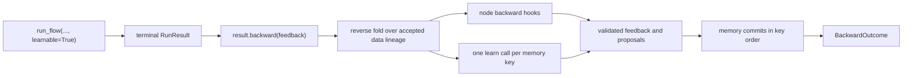

# Learning from feedback

A **learnable run** retains the accepted execution needed to examine a finished
flow and learn from feedback later. It does not retrain a model, rewrite the
authored graph, or change values during forward execution. The application decides
whether to enable retention and when to submit feedback.



Forward and backward have separate results. `RunResult.status`, `output`,
`failure`, and `events` describe forward execution and never change when the
application calls `backward()`. The returned `BackwardOutcome` describes that
explicit attempt; `RunResult.backward_outcome` exposes the latest observed one,
and `RunResult.learning` is its learning projection.

## Retention and memory are separate

`learnable=True` makes a run learnable. It retains accepted inputs, outputs, selected
data routes, and invocation context so a later reverse pass can attribute
feedback. It does **not** require a memory backend, and it does not call a learner
during forward execution.

`memory=` is separate host-provided infrastructure for recall and durable memory
updates. An authored `long_term_memory` declaration names memories, each
identified by a memory key; the host supplies one backend per key, usually with
`build_memories(flow)`. Recall and optional session history can be enabled
without `learnable=True`, and a learnable run can operate without any memory.

`yian run` builds every declared built-in memory automatically, in RAM for
the process. `yian run --memory-root DIR` (or `--memory-storage KEY=PATH`)
keeps built-in memories on disk. It does not enable learning or call
`backward()`. Session history still advances during forward, while saving
episodic or reflective learning requires the explicit Python API. See
[CLI memory](cli.md#memory-and-storage).

| Setting | What it enables | What forward execution does |
| --- | --- | --- |
| `learnable=True` | Retained execution and a later `backward()` call | Records accepted facts; does not learn or commit |
| `memory={...}` | Recall and optional session history for declared memories | Opens memory snapshots, recalls context, and advances enabled session history |
| Both | Feedback-informed per-memory learning plus forward memory capabilities | Retains execution and uses memory; does not run learners or commit learned mutations |

This separation lets an application collect evaluator feedback without a memory
backend, or use recalled context in an ordinary non-learnable run.
[`SessionMemory`](api.md#sessionmemory-foundation) saves actual API conversation
exchanges automatically during forward. These history updates are not learning.
Explicit API backward self-feedback can become committed notes for future calls
through the existing memory lifecycle, without another model call. No-feedback
backward adds no session notes; raw conversation history stays unchanged.
API context summaries are separate from learning: forward execution may summarize
older turns with the current model while preserving raw history and recent whole
turns. The history budget does not include learned-note recall.

## Start an explicit backward attempt

Call `backward()` only after the forward run is terminal. Feedback may be a string,
a partial record matching the output shape, an exact-length positional list, or
`None`. A string addresses the whole output; omitted record fields and `None`
positions contribute no feedback. Every list must match the recorded list length at
every depth. A failed forward result accepts only a string or `None` because it has
no successful output shape.

```python
from yian import run_flow

result = run_flow(flow, {"topic": "routing"}, learnable=True)
forward_output = result.output

outcome = result.backward({
    "summary": "Too long.",
    "tags": [None, "This tag is irrelevant."],
})

assert outcome.status == "succeeded"
assert result.output == forward_output
```

Invalid feedback is rejected before the attempt opens a memory session or records
an attempt. An empty string is still feedback. Calling `backward()` with no
external feedback skips AGENT model work when nothing reaches an AGENT, while
every declared memory key can still learn from its accepted history.

For the complete public call and exact feedback examples, see
[explicit backward feedback](api.md#explicit-backward-feedback).

## How feedback travels

The reverse pass walks the **accepted data lineage**, not scheduling or control
edges. It therefore follows the branch that CASE actually selected, preserves
separate MAP and LOOP occurrences, and delivers an ordered tuple when several
downstream messages reach the same occurrence. A list remains one structured
message inside that tuple; the runtime does not merge independently supplied
feedback into new prose.

START, END, and structural child-flow boundaries transfer feedback mechanically.
Compositional expression operations preserve paths through projections, records,
lists, concatenation, and repetition. Opaque expression functions stop feedback:
the runtime cannot safely infer which input field caused a custom function's
output.

Changed (TS yian): repetition is gone, so feedback has no repetition step.

Each reached behavioral occurrence receives its retained `BackwardContext` and
ordered feedback tuple. The context keeps canonical JSON, so a file in it is its
mapping `{uri, mime, name}`, not a `FileRef`. Its `backward()` hook returns three channels:

| Channel | Destination |
| --- | --- |
| `input_feedback` | Declared input names, routed upstream through retained selected-data routes |
| `self_feedback` | The occurrence's own learning context |
| `variable_feedback` | The occurrence's declared local variables, retained as advice only |

Changed (TS yian): a feedback batch is an array, not a tuple, and `BackwardContext` and
`BackwardResult` hold frozen copies of their values: read them, and copy a value before
changing it.

The base hook returns empty channels and stops transfer. An AGENT can make one
tool-free model call from its accepted rendered prompt, locals, evidence, and
effective model configuration. No prompt rendering, recall, tool execution,
forward node, or expression function runs again. Variable feedback does not
update variables or rewrite the graph.

See [runtime nodes](nodes.md#the-contract) for the hook contract and
[the engine](engine.md#explicit-backward-attempts) for the reverse-fold rules.

## What memory may learn

Each memory key is edited only by its own learner. A node or child flow may
contribute feedback and history to a memory in its stack, but only that
memory's learner can propose mutations for it.

On `backward()`, every memory key gets exactly one `learn` call, in sorted key
order, even with an empty batch. The batch holds every accepted occurrence
whose recorded stack contains the key, of any node kind, with its episode and
attributed feedback. Unattributed root feedback goes only to memories declared
on the root file's flow; an imported file's flow memory, such as `lib.notes`,
does not receive it. The memory decides whether execution history, feedback,
or both justify a proposal. For example, an episodic memory can append a record
while a reflective memory can propose a lesson.

The engine stays memory-neutral. It supplies the retained context, validates the
proposal, and later invokes the memory's existing commit interface; it does not
invent lessons or perform backend-specific writes. See
[injecting agent memory](api.md#injecting-agent-memory) for the host-side
interfaces and [AGENT memory](agent.md#memory-is-an-outer-to-local-stack) for
recall order.

Memory JSON has its own nesting bound of 128 levels: the value limit plus 28, so
lowering `YIAN_MAX_VALUE_NESTING` lowers it too (see [Defaults and
limits](defaults.md)). A run value nests at most 100 levels ([nesting
limit](typing.md#nesting-limit)) and an episode or feedback entry wraps it about 8
levels deeper, so run material always fits; an AGENT's structured value or tool-call
arguments past the limit fail at the reply, so they never become evidence. When a learn
context still cannot be built, for example from a log recorded before the value limit,
the attempt fails with `memory.invalid_context` before any learner runs. The
`BackwardFailure` names the occurrence whose episode or feedback failed (`node_id`,
`node_started_seq`, `scope`, `run_id`), and its message gives the cause:
`memory learn context could not be constructed for node 'n': ... nests deeper than
the memory limit of 128 levels (derived from YIAN_MAX_VALUE_NESTING)`. Only a failure in
the root flow's fallback feedback names no node.

Changed (TS yian): there is no 128-level bound. The memory carriers (snapshots, mutation
payloads, learn feedback, storage state) have no depth limit; values are bounded by value
nesting where they are produced.

## Episodic memory

`EpisodicMemory` is the built-in deterministic history memory. Declare it, for
example `long_term_memory: {notes: episodic}`, and `build_memories` constructs
it; import it from `yian.memory.episodic` to build one yourself. It
proposes one append mutation for every `MemoryEpisode` in its batch, including
executions without external feedback. Nothing is appended during forward
execution: `learnable=True` retains the episode, and a successful later
`backward()` attempt commits it.

Each memory has two optional positive integer limits, set by YAML `config` or
the constructor. An unset limit adopts the stored value, else the default
(`YIAN_EPISODIC_MAX_EPISODES` and `YIAN_EPISODIC_RECALL_LIMIT`,
`YIAN_REFLECTIVE_MAX_ITEMS` and `YIAN_REFLECTIVE_RECALL_LIMIT`; see
[Defaults and limits](defaults.md)); a different explicit value raises
`episodic.config_conflict`. `ReflectiveMemory` limits (`max_items`, `recall_limit`)
follow the same rule with `reflective.config_conflict`. `max_episodes` bounds the stored
history and evicts its oldest entries after a commit. `recall_limit` bounds contextual
AGENT recall. Contextual recall uses deterministic lexical overlap and recency;
context-free recall returns the complete bounded history in chronological order. Entries
are canonical JSON and preserve the run ID, occurrence, owner path, inputs, outcome or
failure, prompts, recalled sections, visible model/tool interactions, and accepted
execution sequence.

By default the backend lives only in the current process. Reusing one instance shares
committed episodes with later fresh runs; `reset()` clears them. Run sessions pin
an immutable snapshot, so recall remains stable while another session commits.
Recorded JSON snapshots can restore a pristine instance for recovery.

The episodic, reflective, and session backends support optional
`storage="./memory.sqlite"` on their constructors. Episodic episodes, reflective
lessons, and session history/notes then survive restarts, along with private
commit deduplication. A file has one owning backend until explicit close or
context exit. Idle run handles allow close;
active operations and queued turns do not. Storage does not trigger learning:
episodes and lessons still require explicit backward, while session conversations
advance automatically during forward execution. See
[durable memory](api.md#optional-durable-memory) for the complete lifetime and
recovery contract.

## Profile memory

`ProfileMemory` keeps one markdown document per instance, for example one per
person. Import it from `yian.memory.profile`, give it a store, and
pass it under the memory key your flow declares. For a flow that declares
`long_term_memory: {about: profile}`:

```python
from yian.memory.profile import ProfileMemory
from yian.memory.storage import FileMarkdownStore

profile = ProfileMemory(FileMarkdownStore("people/ada.md"))
result = run_flow(flow, inputs, memory={"about": profile}, learnable=True)
```

Changed (TS yian): import `ProfileMemory` from `@ngocbh/yian` and pass it in a `Map`
(`memory: new Map([["about", profile]])`).

- **Recall.** A run pins the version that is current when it starts. Every AGENT
  whose stack holds the profile's key sees the whole document, even while
  someone edits it. A profile memory is one key like any other. YAML `config`
  accepts `max_chars` and `input_budget_chars`.
- **Learning.** `backward(feedback)` makes one tool-free model call. It sends the
  current document, the version the run saw when it differs, the feedback, and
  recent AGENT episodes within `input_budget_chars` (default 24,000,
  `YIAN_PROFILE_INPUT_BUDGET_CHARS`). The newest
  episode is always sent; if it alone is over the budget, it is cut to a prefix
  and a suffix. Older episodes are added whole while they fit. Each episode
  includes its visible model replies, tool calls, and tool results. The
  reply must be the whole document inside `<profile>` tags and at most
  `max_chars` (default 32,000, about 8k tokens, `YIAN_PROFILE_MAX_CHARS`). No feedback,
  or an unchanged
  document, proposes nothing. `llm_config=None` uses the ambient model defaults.
- **Commit.** A compare-and-set write against the version the learner read. It
  never calls a model. If someone edited the document in between, the attempt
  fails with the retryable code `profile.version_mismatch` and nothing is
  written; start a new backward attempt to learn from the edited text. Other
  commit failures (`profile.store_unavailable`, `profile.store_invalid`) are not
  retryable, because the write may have landed.
- **Interrupted attempts.** If the process dies during commit, the resumed run
  reports the memory as `unknown`, with its `commit_id`, in
  `result.backward_outcome.learning.policies`. The write may have landed. Before
  you retry, look for that `commit_id` in the store's write provenance. If it is
  there, the feedback is already applied. A missing entry is not proof that
  nothing landed: a crash between the file write and the log append leaves no
  entry. Compare the current document with the `text` in the attempt's
  `memory_commit_requested` run-log record. A new attempt also tells the learner
  not to repeat what the document already says.
- **Recovery.** The session snapshot records only the version and a hash of the
  text. `resume_flow(..., memory=...)` and later backward reopen that exact
  version, so the store must keep every version it handed out. An unknown
  version is a `MemorySetupError`, from `resume_flow` for an unfinished run and
  from each backward attempt for a finished one. The run log still holds
  profile text: AGENT evidence has the recalled document, and learning records
  have the proposed one. Keep run logs as private as the profile.
- **Host edits.** `profile.read()` returns `(text, version)`, and
  `profile.write(text, base_version=version)` is the same compare-and-set without
  a size limit. `reset()` is refused; delete or rewrite the file through the store.
- **Close.** `profile.close()` does no I/O. Afterwards `open_run`, `reset`,
  `read`, `write`, and its open sessions raise `MemoryOperationError` with code
  `profile.closed`. A registry from `build_memories` closes the profiles it built.

Changed (TS yian): the learner's material is the text form (`1.0` is `1`, bare `Infinity`, JS
key order), lengths (`max_chars`, `input_budget_chars`) count code points, and blank and
unchanged checks use JS `trim()` where Python uses `strip()`. Feedback values dedupe by their
JSON text, so the int `2`, the float `2.0` and `true` stay distinct (Python's `==` merges them).

Feedback holding `±Infinity` fails `profile.invalid_context` when a proposed mutation would carry
it.

Changed (TS yian): reflective and profile learners, and AGENT backward, retry a failed model call
like any other model call (`YIAN_MODEL_RETRIES`); before each wait they publish a transient
`ModelCallRetried` event (`consumer` `"memory:<key>"` under the node id `__memory__`, or
`"backward"` under the AGENT's id). Learners publish to the `onEvent` given to `buildMemories`, which
also takes the `models` they build through; AGENT backward publishes to the backward call's
`onEvent`.

`FileMarkdownStore(path)` keeps the current document as a plain editable file.
The file holds the text exactly as written, line endings included, so `\r\n`
reads back as `\r\n` and the version always hashes the text `read` returns.
`path` must be a local file path: empty, `:memory:`, and `file:` URIs raise
`MemoryOperationError` with code `storage.path`. Next to it are
content-addressed copies of every version it has handed out
(`.<name>.versions/`), a lock file, and a write log (`.<name>.writes.jsonl`).
A symlinked `path` is resolved when the store is built, as SQLite storage does:
writes update the link's target, and these files sit next to the target.
Each write-log line is JSON with `base_version`, `version`, and `provenance`.
From `ProfileMemory`, provenance holds `run_id`, `commit_id`, `seen_version`,
and the distinct `feedback` values. Provenance that is not a JSON object of
finite JSON values raises `TypeError` or `ValueError` before anything is
written. A crash while appending can
leave a partial last line; readers should skip lines that are not valid JSON.
Locking is single-host. Other storage implements the `MarkdownStore` protocol:
`read(version=None) -> (text, version)` and
`write(text, *, base_version, provenance=None) -> version`. Versions are opaque
strings the store chooses (a git blob id works), and `read(version)` returns
that same version. The store raises `MarkdownVersionMismatch` when
`base_version` is stale (nothing was written), `LookupError` for an unknown
version, `ValueError` for text it cannot decode, and `OSError` when storage
cannot be reached.

Changed (TS yian): `read(version?)` returns `[text, version]`, and
`write(text, { baseVersion, provenance })` returns the version. `FileMarkdownStore` answers
with a promise and `InMemoryMarkdownStore` answers at once; a host store may do either, and
yian awaits. An unknown version, or stored text that isn't UTF-8, throws `RangeError`. Storage
that can't be reached throws a Node system error, an `Error` with a string `code` and a string
`syscall` or a numeric `errno` (for example `code: "EIO", syscall: "read"`): `ENOENT` for a
missing parent directory, `EIO` when the lock fails. Bad provenance throws `TypeError` or
`RangeError` naming `provenance`, and nothing is written. The document, the kept versions
(`.<name>.versions/<sha256>.md`), and the write log are byte-compatible with Python yian's,
so a profile directory written by Python opens in TS and continues. Each log line is exactly
what Python's `json.dumps(sort_keys=True)` writes. A whole-number JS `number` in provenance is
written as a float (`2.0`); pass `2n` for an int. TS locks `.<name>.lock` with SQLite, not
`flock`, so the lock file must stay an empty regular file, and Python's and TS's locks don't
see each other. Don't let Python yian and TS yian write the same profile at the same time: both
could pass the compare-and-set, and one update would be lost. In a run, profile memory turns a
`MarkdownVersionMismatch` into `profile.version_mismatch`, a Node system error into
`profile.store_unavailable` and a `RangeError` into `profile.store_invalid`; on restore, a
`RangeError`, a `TypeError` or a Node system error becomes `profile.snapshot_unavailable`. Any
other error passes through unchanged.

## Compute first, then commit

One backward attempt has two phases:

1. Run the reverse fold and one `learn` call per memory key. The runtime
   validates all feedback and proposals before it accepts `BackwardReadyRecord`.
2. Commit each memory key's complete batch in sorted key order. Empty batches
   are still valid commits.

A callback or learner failure finishes the attempt as failed before any memory
commit begins. Memory commits are individually durable; there is no rollback
across memory keys. The learning result records each memory key as
`unrequested`, `unknown`, `succeeded`, or `failed`, in `learning.policies`
entries whose `.memory` names the key. `unknown` means the runtime recorded a
request but did not durably observe the backend result.

Every `backward()` call is a new attempt on the same run, whatever the earlier
attempts did: succeeded, failed, committed, or crashed. Each attempt opens fresh
sessions from the run's original snapshots and recomputes all callbacks and
proposals. An unfinished earlier attempt, such as one killed during a commit, is
first closed as interrupted; its unconfirmed requests stay `unknown`. The runtime
never resumes a half-computed attempt, retries automatically, rebases a memory,
or rolls back a different memory's confirmed commit.

Attempts are distinct for memory. Every attempt's commit IDs (`ac-memory-v3:`)
include its attempt number, so a backend that deduplicates by commit ID still
applies an identical later batch. This also means a new attempt after an
`unknown` request may write twice: the backend may have applied the first
request, and it cannot match the new ID to it. The host reconciles, for example
by checking the store before it calls `backward()` again. A learner sees only
the current attempt's feedback, never an earlier attempt's. A memory may still
reject a later attempt: the built-in `EpisodicMemory` and `ReflectiveMemory`
fail `learn` with a `stale_generation` code once their memory has moved past
the run's snapshot.

Changed (TS yian): the commit-ID digest input is yian's run-log canonical JSON
(`logJson`), not Python's sorted compact `json.dumps`. The two texts differ only
for floats, for objects shaped like the codec's escapes (`{"$record": ...}`,
`{"$float": "inf"}`), and for the order of keys holding characters outside the
Basic Multilingual Plane; elsewhere the IDs match. A run log never spans both
implementations, so the prefix stays `ac-memory-v3`.

## Durable feedback and recovery

Use a JSONL run log when feedback may arrive in a later process:

```python
from pathlib import Path
from yian import run_flow
from yian.run import resume_flow

log = Path("reviewable-run.jsonl")
result = run_flow(flow, {"topic": "routing"}, log=log, learnable=True)

# Later, possibly in another process:
recovered = resume_flow(flow, log=log)
outcome = recovered.backward("Make the explanation shorter.")
```

Recovery folds the same append-only records used live and reconstructs the
retained reverse tape. It never starts backward work or memory learning by itself.
For a memory-enabled backward attempt, pass a mapping with the same memory keys,
such as `build_memories(flow, ...)` over the same storage, to
`resume_flow(..., memory=...)` so it can reopen the recorded snapshots. You may
call `backward()` on the same log again later, from any process; each call appends
a new attempt. The run handle and durable log reject overlapping backward attempts.

Run logs retain prompts, typed values, feedback, snapshots, proposals, and often
model/tool evidence. Treat them as sensitive data and store them on an
access-controlled path. The [durable recovery guide](api.md#durable-recovery-with-resume_flow)
documents the locking and interrupted-forward boundary.

## Boundaries of the mechanism

Learning from feedback helps a memory improve its own state for later
runs. It does not change an already completed forward result. It also does not:

- choose a different authored path or edit the flow graph;
- apply variable feedback as a replacement value;
- rerun node forward calls, tools, prompts, recall, or opaque functions;
- make commits atomic across memory keys; or
- guarantee exactly-once external effects after an interrupted forward node.

Those boundaries keep the authored flow deterministic while making feedback,
learning proposals, commits, and recovery inspectable through the same durable
record authority.
