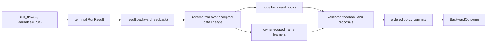

# Learning from feedback

A **learnable run** retains the accepted execution needed to examine a finished
flow and learn from feedback later. It does not retrain a model, rewrite the
authored graph, or change values during forward execution. The application decides
whether to enable retention and when to submit feedback.



Forward and backward have separate results. `RunResult.status`, `output`,
`failure`, and `events` describe forward execution and never change when the
application calls `backward()`. The returned `BackwardOutcome` describes that
explicit attempt; `RunResult.backward_outcome` exposes the latest observed one,
and `RunResult.learning` is its learning projection.

## Retention and memory are separate

`learnable=True` makes a run learnable. It retains accepted inputs, outputs, selected
data routes, and invocation context so a later reverse pass can attribute
feedback. It does **not** require a memory backend, and it does not call a learner
during forward execution.

`memory=` is separate host-provided infrastructure for recall and durable policy
updates. An authored `long_term_memory` declaration chooses a policy name; the
host supplies its implementation under that name. Recall can be enabled without
`learnable=True`, and a learnable run can operate without any memory policy.

| Setting | What it enables | What forward execution does |
| --- | --- | --- |
| `learnable=True` | Retained execution and a later `backward()` call | Records accepted facts; does not learn or commit |
| `memory={...}` | Recall for declared memory frames | Opens policy snapshots and provides recalled context |
| Both | Feedback-informed frame learning | Retains execution and recalls; still does not write memory |

This separation lets an application collect evaluator feedback without a memory
backend, or use recalled context in an ordinary non-learnable run.

## Start an explicit backward attempt

Call `backward()` only after the forward run is terminal. Feedback may be a string,
a partial record matching the output shape, an exact-length positional list, or
`None`. A string addresses the whole output; omitted record fields and `None`
positions contribute no feedback. Every list must match the recorded list length at
every depth. A failed forward result accepts only a string or `None` because it has
no successful output shape.

```python
from agent_composer import run_flow

result = run_flow(flow, {"topic": "routing"}, learnable=True)
forward_output = result.output

outcome = result.backward({
    "summary": "Too long.",
    "tags": [None, "This tag is irrelevant."],
})

assert outcome.status == "succeeded"
assert result.output == forward_output
```

Invalid feedback is rejected before the attempt opens a memory session or records
an attempt. An empty string is still feedback. Calling `backward()` with no
external feedback skips AGENT model work when nothing reaches an AGENT, while
enabled memory frames can still learn from their accepted history.

For the complete public call and exact feedback examples, see
[explicit backward feedback](api.md#explicit-backward-feedback).

## How feedback travels

The reverse pass walks the **accepted data lineage**, not scheduling or control
edges. It therefore follows the branch that CASE actually selected, preserves
separate MAP and LOOP occurrences, and delivers an ordered tuple when several
downstream messages reach the same occurrence. A list remains one structured
message inside that tuple; the runtime does not merge independently supplied
feedback into new prose.

START, END, and structural child-flow boundaries transfer feedback mechanically.
Compositional expression operations preserve paths through projections, records,
lists, concatenation, and repetition. Opaque expression functions stop feedback:
the runtime cannot safely infer which input field caused a custom function's
output.

Each reached behavioral occurrence receives its retained `BackwardContext` and
ordered feedback tuple. Its `backward()` hook returns three channels:

| Channel | Destination |
| --- | --- |
| `input_feedback` | Declared input names, routed upstream through retained selected-data routes |
| `self_feedback` | The occurrence's own learning context |
| `variable_feedback` | The occurrence's declared local variables, retained as advice only |

The base hook returns empty channels and stops transfer. An AGENT can make one
tool-free model call from its accepted rendered prompt, locals, evidence, and
effective model configuration. No prompt rendering, recall, tool execution,
forward node, or expression function runs again. Variable feedback does not
update variables or rewrite the graph.

See [runtime nodes](nodes.md#the-contract) for the hook contract and
[the engine](engine.md#explicit-backward-attempts) for the reverse-fold rules.

## What memory may learn

Memory belongs to the flow or AGENT frame that declared it. A node or child flow
may contribute feedback and history to an ancestor frame, but it cannot mutate
that inherited frame. Only the receiving frame's learner can propose mutations
for its own memory.

After the reverse fold, every enabled frame receives an owner-scoped
`LearnContext` in recorded layout order. This includes frames with empty feedback,
empty history, or no reached occurrence. The policy decides whether execution
history, feedback, or both justify a proposal. For example, a history database
can append a record while a reflective policy can propose a lesson.

The engine stays policy-neutral. It supplies the retained context, validates the
proposal, and later invokes the policy's existing commit interface; it does not
invent lessons or perform backend-specific writes. See
[injecting agent memory](api.md#injecting-agent-memory) for the host-side policy
interfaces and [AGENT memory](agent.md#memory-is-an-outer-to-local-stack) for
recall order.

## Episodic memory

`EpisodicMemory` is the built-in deterministic history policy. Import it from
`agent_composer.memory.episodic` and inject it under the authored `episodic`
name. It proposes one append mutation for every owner-scoped `MemoryEpisode` it
receives, including executions without external feedback. Nothing is appended
during forward execution: `learnable=True` retains the episode, and a successful
later `backward()` attempt commits it.

Each static frame has two positive integer settings. `max_episodes` bounds the
stored history and evicts its oldest entries after a commit. `recall_limit`
bounds contextual AGENT recall. Contextual recall uses deterministic lexical
overlap and recency; context-free recall returns the complete bounded history in
chronological order. Entries are canonical JSON and preserve the run ID,
occurrence, owner path, inputs, outcome or failure, prompts, recalled sections,
visible model/tool interactions, and accepted execution sequence.

The backend lives only in the current process. Reusing one instance shares
committed episodes with later fresh runs; `reset()` clears them. Run sessions pin
an immutable snapshot, so recall remains stable while another session commits.
Recorded JSON snapshots can restore a pristine instance for recovery, but the
backend provides no database or file persistence of its own.

## Compute first, then commit

One backward attempt has two phases:

1. Run the reverse fold and every enabled frame learner. The runtime validates all
   feedback and proposals before it accepts `BackwardReadyRecord`.
2. Commit each policy's complete batch in recorded policy order. Empty batches are
   still valid commits.

A callback or learner failure finishes the attempt as failed before any policy
commit begins. Policy commits are individually durable; there is no cross-policy
rollback. The learning result records each policy as `unrequested`, `unknown`,
`succeeded`, or `failed`. `unknown` means the runtime recorded a request but did
not durably observe the backend result.

A successful attempt, or any accepted commit request, closes retry eligibility.
Before that boundary, the application may call `backward()` again to retry the
whole attempt with fresh sessions from the original snapshots. It never resumes a
half-computed attempt, retries automatically, rebases a policy, or rolls back a
different policy's confirmed commit.

## Durable feedback and recovery

Use a JSONL run log when feedback may arrive in a later process:

```python
from pathlib import Path
from agent_composer import run_flow
from agent_composer.run import resume_flow

log = Path("reviewable-run.jsonl")
result = run_flow(flow, {"topic": "routing"}, log=log, learnable=True)

# Later, possibly in another process:
recovered = resume_flow(flow, log=log)
outcome = recovered.backward("Make the explanation shorter.")
```

Recovery folds the same append-only records used live and reconstructs the
retained reverse tape. It never starts backward work or memory learning by itself.
For a memory-enabled backward attempt, pass the original policy mapping to
`resume_flow(..., memory=...)` so it can reopen the recorded snapshots. The run
handle and durable log reject overlapping backward attempts.

Run logs retain prompts, typed values, feedback, snapshots, proposals, and often
model/tool evidence. Treat them as sensitive data and store them on an
access-controlled path. The [durable recovery guide](api.md#durable-recovery-with-resume_flow)
documents the locking and interrupted-forward boundary.

## Boundaries of the mechanism

Learning from feedback helps a policy improve its own memory state for later
runs. It does not change an already completed forward result. It also does not:

- choose a different authored path or edit the flow graph;
- apply variable feedback as a replacement value;
- rerun node forward calls, tools, prompts, recall, or opaque functions;
- make a memory backend's commits cross-policy atomic; or
- guarantee exactly-once external effects after an interrupted forward node.

Those boundaries keep the authored flow deterministic while making feedback,
learning proposals, commits, and recovery inspectable through the same durable
record authority.
