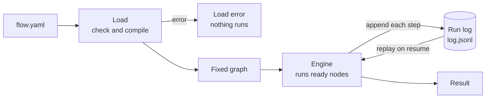
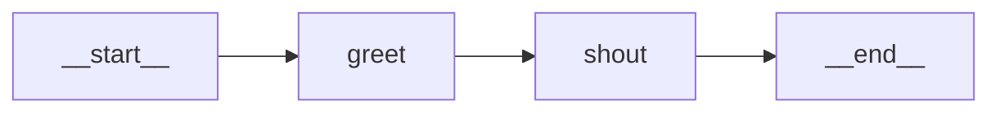

This page explains what happens when yian runs a flow: how a flow becomes a graph, how each step
of a run is written to a log, and how yian uses that log to pick a run up after a crash. Read it
when you want to know what a run log holds, or what runs again after a resume.

## The big picture

yian works in two phases. Loading turns your YAML into a fixed graph of nodes. Running walks that
graph and writes every step to an append-only run log. The log is the only record of the run:
yian can rebuild any run from it.



This page uses one small flow throughout. It greets a name, then shouts the greeting.

```yaml title="greet.yaml" check=runnable
id: greet
name: greet
input:
  name: !str
nodes:
  greet:
    kind: code
    input:
      name: ${input.name}
    output: str
    code: |
      return "hi " + inputs.name
  shout:
    kind: code
    input:
      text: ${greet.output}
    output: str
    code: |
      return inputs.text.toUpperCase()
output: ${shout.output}
```

```console
$ yian run greet.yaml --input name=Ada
HI ADA
```

## The fixed graph

Loading does all of its checks before anything runs. It parses the file, checks the types and
expressions, and compiles the flow into a graph. A flow with an error never starts a run.

The graph has a node for each entry under `nodes:`, plus two that every flow gets:

| Node | Id | What it does |
|---|---|---|
| START | `__start__` | Takes the run's inputs and checks them against `input:` |
| END | `__end__` | Builds the flow's result from `output:` |

Edges come from your references. When a node reads `${greet.output}`, yian adds an edge from
`greet` to that node. `${input.name}` adds an edge from START. `depends_on:` and `runs_after:` add
ordering edges that carry no value. The graph can't have a cycle; a cycle is a load error.

For `greet.yaml` the graph is:



The graph is fixed in two ways:

- **One graph, many runs.** Each run works on its own copy, so a loaded flow can back any number
  of runs.
- **Nodes don't edit the graph.** A node gets its inputs and returns a result. It can't add nodes,
  change edges or write another node's value.

The one way a run's graph grows is through `call`, `map` and `loop`. When one of them runs, it
expands its child flow into the same graph: the child's nodes join the run, with their own START
and END. There is no separate child run and no separate log. Expanded nodes get ids that say where
they came from, so the same run always builds the same ids:

| Id | Node |
|---|---|
| `review` | A node you wrote |
| `fetch/parse` | Node `parse` inside the `call` node `fetch` |
| `each#2/echo` | Node `echo` for item 2 of the `map` node `each` (items count from 0) |
| `loop#1/step` | Node `step` in turn 1 of the `loop` node `loop` (turns count from 0) |
| `loop~2` | The check that decides whether `loop` runs turn 2 |

Each loaded flow also has a fingerprint: a SHA-256 hash of the compiled graph. The run log
records it, and a resume checks it.

## Running the graph

The engine drives the run. It repeats one cycle:

1. Pick a node whose inputs are all settled.
2. Write `node_started`, then run it. The node gets its inputs and returns one outcome.
3. Write the outcome's records to the run log.
4. Apply it to the run's state, then tell listeners (events, progress lines).

Writing comes before applying. If the write fails, the step didn't happen: the state doesn't
change and no event goes out. So the log is never behind the state.

Each node returns one of these outcomes:

| Outcome | Records written | What changes |
|---|---|---|
| A value | `pool_commit` (an agent adds one for its messages), then `node_succeeded` | The value is stored under the node's id; nodes that read it can run |
| A route (`case`) | `node_routed` | The branches not taken are skipped |
| An expansion (`call`, `map`, `loop`) | A `pool_commit` for each child START, then `node_expanded` | The child flow's nodes join the graph |
| A wait (`take`, `sleep`, `ask`, a host call) | `node_waiting` | The node is set aside until what it waits on arrives. A `take` whose event is already there, or a `sleep` already due, stores its value at once instead |
| A failure | `node_failed` | The run fails |

The engine never asks what kind a node is. It reacts only to the outcome, so every node kind runs
the same way.

### Running nodes at the same time

By default up to 8 nodes run at once. Set `--num-workers` (or `numWorkers` in code) to change
that; `0` runs one node at a time. With several workers, outcomes are written in the order the
nodes finish. Workers only run nodes; the engine writes every record, so the log stays one ordered
list either way.

A waiting node doesn't hold a worker. It goes back to work when its event, answer or deadline
arrives. See [Inboxes and waiting](/inboxes/).

### How a run ends

| Ending | When |
|---|---|
| Succeeded | END has its value and no node is still running |
| Failed | A node failed (`node_failed`), or a route left END unable to run; if nodes still wait then, yian writes `run_failed` |
| Waiting | Nothing can run and some nodes are waiting; yian writes `run_waiting` |
| Cancelled | The host cancelled the run; yian writes `run_cancelled` |

A failed flow is still a finished run with a result. Problems outside the flow, such as a log file
that can't be written, stop the run with an error instead.

## The run log

Each run has one log: a JSON Lines file with one record per line. `yian run` keeps it at
`~/.yian/runs/<run_id>/log.jsonl`, or at the path you give with `--log`. A host program passes a
path as the `log` option; without one, the log stays in memory and the run can't be resumed.

The log is append-only:

- Each record is written and synced to disk before the engine applies it.
- A record is never changed or removed. A resume adds records after the old ones.
- One process writes at a time. It holds a lock on `<log>.lock`; a second writer is refused.
  A `<log>.lock` that holds other data is refused with its path; when no run is active, removing
  it is safe.
- The file is readable only by you (mode 0600).

Every line has the same envelope. This is the record that stores `greet`'s value:

```json
{"at":"2026-10-27T08:43:00.746Z","kind":"pool_commit","payload":{"key":"greet","kind":"str","node_id":"greet","value":"hi Ada"},"run_id":"281f84a4cdb54f26a59aaa23c0f1b593","schema":30,"seq":9}
```

| Field | Meaning |
|---|---|
| `schema` | The log format version. This yian reads and writes only schema 30 |
| `run_id` | The run's id; the same on every line |
| `seq` | The record's place in the log, from 0 with no gaps |
| `at` | When the record was written (UTC). Use `seq` for order, since clocks can move |
| `kind` | The record kind, such as `node_started` |
| `payload` | The record's data |

### A run, record by record

Running `greet.yaml` writes 17 records:

| seq | kind | Node | What it says |
|---|---|---|---|
| 0 | `run_started` | | The run's setup (below) |
| 1–3 | `pool_commit` | `__start__` | The values of `system.now`, `system.run_id` and `system.today` |
| 4 | `pool_commit` | `__start__` | The inputs, `{"name": "Ada"}` |
| 5–7 | `node_started`, `pool_commit`, `node_succeeded` | `__start__` | START checks the inputs |
| 8–10 | `node_started`, `pool_commit`, `node_succeeded` | `greet` | `greet` stores `"hi Ada"` |
| 11–13 | `node_started`, `pool_commit`, `node_succeeded` | `shout` | `shout` stores `"HI ADA"` |
| 14–16 | `node_started`, `pool_commit`, `node_succeeded` | `__end__` | END stores the result |

A node's value is written first, then its `node_succeeded` names it (`"commit": 9`). The value
counts only once that success is in the log.

The `run_started` record holds everything the run needs to be rebuilt later:

| Recorded | Not recorded |
|---|---|
| The flow's fingerprint, the text of every flow file it loaded, and its code root | API keys and header values |
| Each agent's resolved model settings | The host's own objects (a tool's `ctx.context`) |
| The worker count | |
| The `YIAN_*` settings that differ from the defaults | |
| The descriptions of the tools and skills agents use | |
| The yian version | |

A [memory](/memory/) input's value, in START's inputs, holds the memory's identity, settings,
tools, version and recall, never its location.

Steps inside a node are records too. An agent writes a `node_step` for each model reply and each
tool result, as it goes. A tool that retries writes one for each failed attempt and one as the next
attempt starts.
[Reference](/reference/) lists every record kind and its fields.

To see where a run stands, give its log to `yian status`:

```console
$ yian status ~/.yian/runs/281f84a4cdb54f26a59aaa23c0f1b593/log.jsonl
status: succeeded
```

## Replay

yian saves no state besides the log. To learn where a run stands, it replays the log: it reads
the records in order and applies each one to a fresh copy of the graph, exactly as the engine did
when it wrote them. Replay runs none of your code, calls no model or tool, and sends no events.

Replay rebuilds:

- the graph, including every child flow that `call`, `map` and `loop` expanded;
- every stored value;
- which nodes finished, which were running and which are waiting;
- each node's recorded steps, such as an agent's model replies.

Some values are rebuilt rather than read. When a child flow's END or a loop passes a value on,
the log stores pointers to the records it came from, and replay computes the value again.

The flow comes from the log too. When you resume, yian compiles the flow files saved in
`run_started`. It never reads them from disk, so editing `greet.yaml` doesn't change a run that
already started; start a new run to use your edits. If the saved files don't compile to the
recorded fingerprint, the resume is refused. A host that built its flow in code passes it again,
and its fingerprint must match.

## Crash recovery

If the process dies mid-run, the log still holds every step that finished. The last line may be
cut off; yian ignores it. Here another run of `greet.yaml` was cut while `shout` was running:

```console
$ yian status ~/.yian/runs/9b3e07d2c41a4f8e8d6a5f1c2e7b4a90/log.jsonl
status: crashed
in flight: shout
crashed attempts: shout=1
```

Resume it with `--resume`. yian runs the flow the log recorded, so you don't name the flow file:

```console
$ yian run --resume ~/.yian/runs/9b3e07d2c41a4f8e8d6a5f1c2e7b4a90/log.jsonl
HI ADA
```

A resume does this:

1. Takes the log's lock, and drops a cut-off last line.
2. Checks every record and the flow's fingerprint.
3. Replays the log.
4. Writes `run_resumed`, listing the nodes that started but never finished.
5. Runs those nodes again first, then carries on with the rest of the graph.

`greet` isn't run again: its value is in the log. In code, `advance({ log })` does the same; see
[Embedding yian](/embedding/).

### What a resume does with each run

| Status | Means | What a resume does |
|---|---|---|
| `succeeded`, `failed`, `cancelled` | The run ended | Returns the recorded result and writes nothing |
| `waiting` | Every unfinished node is waiting | Wakes the nodes whose answer or deadline has arrived; if none has and `--num-workers` is unchanged, writes nothing and returns `waiting` |
| `stopped` | The host stopped the run (`run_stopped`) | Runs the stopped nodes again |
| `crashed` | The process ended without a stop | Runs the unfinished nodes again, each counted as a crashed attempt |
| `unstarted` | The process ended before the run's inputs were recorded | Refuses; delete the log and start the run again |
| `running` | Another process holds the lock | Refuses |

### What comes from the log, and what you give again

A resume takes the run's inputs, run id, model settings and worker count from the log. With
`--resume`, a flow file, `--input`, `--inputs`, `--provider`, `--model`, `--embedding` and `--log`
are refused. `--num-workers` is allowed and changes the worker count from then on.

You give these again, since the log doesn't hold them:

| Give again | Why |
|---|---|
| API keys, in the environment | Keys are never recorded |
| The same MCP servers and skills | Agents' tools and skills must match the recorded descriptions, and tools their recorded `resumable` flags |
| The same `YIAN_*` settings | A resume refuses settings that differ from the recorded ones |
| The same memories: the same `--memory` flags, or the same instances to a host's `advance` | A resume opens each again, and refuses one that is missing or differs from the recorded one. Agents keep the recall the run started with |

A resume under another yian version works, with a warning that names both versions.

### What runs again

Replay makes yian's own state exact, but it can't undo what a node did outside yian. A node that
was running when the process died runs again, so its effect may happen twice:

| Node | When it runs again |
|---|---|
| `code` | Runs from the start |
| `tool` | Runs with the same `ctx.callId` and the next `ctx.attempt`. A tool with `retries:` keeps only the retries it had left |
| `agent` | Reuses each recorded model reply and tool result without calling them again. A tool call with no recorded result is sent again, with the same `ctx.callId` and a higher `ctx.attempt`, when its tool is resumable; otherwise it is reported to the model as "The tool call was interrupted; its outcome is unknown. Check its effect before retrying." Then the agent carries on from its first unrecorded model call |
| `case`, `call`, `map`, `loop`, START, END | Computes the same result from the same inputs |

Memory tools are resumable, and a memory applies each change id once, so a memory write that a
crash cut off lands once.

So write tools that change the world to be safe to repeat. Pass `ctx.callId` to the service as an
idempotency key: it stays the same on every attempt and after a resume. Such a tool can say
`resumable: true`, so an agent sends its cut-off call again (see [Host tools](/agents/#host-tools)).
See [Code and tools](/code-and-tools/).
