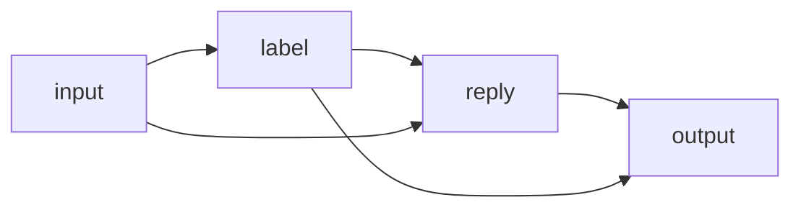

yian runs flows: YAML files that wire agents, code and tools into steps.

## What yian is

You write the graph in a YAML file, and it doesn't change at run time. LLMs fill in values and
choose among the tools you grant. A model's answer can pick among the paths you wrote, but never
adds a step.

- **Wiring you can read.** Steps are wired mostly by data references such as
  `${triage.output}`, so the file shows what runs and what waits for what.
- **Typed values, checked at load.** Every input and output has a type. A flow whose parts don't
  fit fails before it calls a model.
- **An append-only run log.** Each step is logged before it's applied, so a run resumes after a
  crash or a wait, and you can read what happened afterwards.
- **Learning across runs.** Feedback on a run becomes lessons in the flow's memory, which agents
  recall into their prompts on later runs.

## Goals and non-goals

- **Goals:** work that repeats, must be reliable and should improve across runs, such as
  standard operating procedures, routines, reviews, triage and reports. Flows that people and
  LLMs both write, read and fix.
- **Non-goals:** interactive coding agents, and flexible or one-off work. Use Codex, Claude Code
  or OpenCode for that.

## A small flow

This flow labels a support message and then drafts a reply that uses the label:

<!-- yian-test {"replies": ["{\"value\": \"billing\"}", "Sorry about the double charge; we have refunded it."]} -->

```yaml title="triage.yaml" check=runnable
id: triage
name: triage
input:
  message: !str
nodes:
  label:
    kind: agent
    input: {message: "${input.message}"}
    output: Literal(billing, bug, other)
    prompt: "Label this support message: ${message}"
  reply:
    kind: agent
    input: {message: "${input.message}", label: "${label.output}"}
    output: str
    prompt: "Write a one-line reply to this ${label} message: ${message}"
output: {label: "${label.output}", reply: "${reply.output}"}
```

```console
$ yian run triage.yaml --input message="I was charged twice this month."
{"label":"billing","reply":"Sorry about the double charge; we have refunded it."}
```

- `input:` and `output:` give the flow typed boundaries, like a function. Flow inputs take the
  tag form `!str`, which can carry a default (`!int 3`); outputs take a plain type.
- Each entry under `nodes:` is a step. `kind: agent` is a step backed by an LLM.
- A step's `input:` maps names to values (`${input.message}` is the flow's input); its prompt
  reads those names (`${message}`).
- `reply` reads `${label.output}`, so it runs after `label`. You don't draw that edge by hand.
- `Literal(billing, bug, other)` makes the model answer with exactly one of those labels.



## Where to go next

| If you want to | Read |
|---|---|
| Install yian and run your first flow | [Get started](/get-started/) |
| Learn the shape of a flow file | [Flows and nodes](/flows/) |
| Write `${...}` values | [Expressions](/expressions/) |
| Declare input and output types | [Types](/types/) |
| Give an agent tools, skills and memory | [Agents](/agents/) |
| Run your own code in a step | [Code and tools](/code-and-tools/) |
| Choose and log in to a model provider | [Models and providers](/models/) |
| Branch, loop and call other flows | [Control flow](/control-flow/) |
| Wait for messages, answers and time | [Inboxes and waiting](/inboxes/) |
| Improve a flow from feedback | [Learning](/learning/) |
| Look up a `yian` command | [CLI](/cli/) |
| Run flows from your own TypeScript program | [Embedding yian](/embedding/) |
| See how runs are logged and resumed | [How yian works](/how-it-works/) |
| Look up defaults, limits and error codes | [Reference](/reference/) |
| Read complete flows | [Examples](/examples/) |
