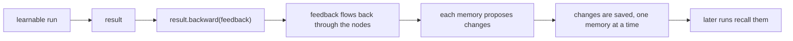

This page explains how a flow improves across runs. A flow declares long-term memories, and its
agents recall them when they run. After a run, your program can give feedback on its output; the
backward pass carries that feedback back through the run and lets each memory learn from it.
Learning never retrains a model, changes the flow, or changes the run's output.



## Declare memory

`long_term_memory:` names memories on a flow (the root file or a `defs:` entry) or on an agent
node. Each memory has a name and a type:

```yaml
id: support
name: support
long_term_memory:
  notes: episodic
  lessons:
    type: reflective
    config: {max_items: 50, recall_limit: 10}
input:
  question: !str
nodes:
  answer:
    kind: agent
    long_term_memory: {about: profile}
    input:
      question: ${input.question}
    output: str
    prompt: Answer ${question}.
output: ${answer.output}
```

| Form | Meaning |
|---|---|
| `long_term_memory: episodic` | One memory named after its type |
| `long_term_memory: {notes: episodic}` | One memory per entry, `name: type` |
| `long_term_memory: {notes: {type: episodic, config: {...}}}` | The long form, with `config` |

| Type | Keeps | Config keys (default) |
|---|---|---|
| `episodic` | A record of each run of the nodes under it | `max_episodes` (100), `recall_limit` (10) |
| `reflective` | Short lessons a model writes from feedback | `max_items` (100), `recall_limit` (20) |
| `profile` | One markdown document, such as notes about a person | `max_chars` (32,000), `input_budget_chars` (24,000) |

- Config values are integers of at least 1. `episodic` and `reflective` keys may be `null`, which
  keeps the stored value or the default. `YIAN_EPISODIC_*`, `YIAN_REFLECTIVE_*` and
  `YIAN_PROFILE_*` set the defaults (see [Reference](/reference/)).
- A built-in type refuses config keys it doesn't list. `storage`, `store` and `path` are refused
  for every type, and so are credential keys such as `api_key`, in any case and at any depth:
  where a memory lives belongs to whoever runs the flow (see [Storage](#storage)).
- `config`, `name` and `type` can't be memory names, and two names that differ only in case are a
  load error.
- Any other type name is a custom type, which a host program builds (see
  [Embedding yian](/embedding/)).
- `long_term_memory: null` is the same as leaving it out; `{}` is a load error. A `session` type is
  a load error: carry a conversation as a loop field instead (see
  [Control flow](/control-flow/)).
- Code, tool, `case`, `call`, `map` and `loop` nodes, and inline bodies, can't declare memory. Use
  a `defs:` entry when a child flow needs its own.

### Memory keys

A memory is known by its key: its name, prefixed by the `uses:` aliases it was imported through.
`notes` in the root file is `notes`; in a file imported as `lib` it is `lib.notes`. The same key
declared twice in one file (on the flow and on an agent, say) is one memory, and its type and
config must agree. Two libraries that both declare `notes` stay apart.

## Recall

Each agent recalls the memories of the flows around it, outermost first, through `call`, `map`
and `loop`, then its own. A key that appears twice is recalled once, at its outermost place.

| Type | What an agent sees |
|---|---|
| `episodic` | Up to `recall_limit` past records, the ones most like this call first |
| `reflective` | Up to `recall_limit` lessons, the ones sharing the most words with this call first |
| `profile` | The whole document |

A run pins each memory as it was when the run started, so recall stays the same while another
run saves changes.

## The backward pass

Learning happens only when a host program asks for it. `yian run` recalls memory but never
learns. A host runs the flow with `learnable: true`, then calls `backward` on the result:

```ts
import { buildMemories, loadFlow } from "@ngocbh/yian";
import { runFlow } from "@ngocbh/yian/run";

const flow = await loadFlow(yamlText);
const memory = await buildMemories(flow, { root: "./mem" });
const result = await runFlow(flow, { question: "How do I reset my password?" }, { memory, learnable: true });
const outcome = await result.backward("Too long. Lead with the steps.");
console.log(outcome.status); // "succeeded" or "failed"
```

Feedback addresses the run's output:

| Feedback | Addresses |
|---|---|
| Text | The whole output |
| A record, such as `{summary: "Too long."}` | Only the fields it names |
| A list as long as the recorded list, such as `[null, "Off topic."]` | Each item by position; `null` skips one |
| `null`, or nothing | No feedback; `episodic` and `reflective` still learn from the run itself |

Records and lists nest to match the output. A field the output doesn't have, or a list of the
wrong length, is refused before anything happens. A failed run takes only text or `null`.

### How feedback travels

The backward pass walks back along the data that made the output, not the order nodes ran in:

- It follows the branch each `case` took, and reaches each `map` item and each `loop` run on its
  own.
- It passes through flow and child-flow boundaries, and through expressions to each of their
  parts: field reads, records, lists, operators and text around `${...}`. A function call in an
  expression stops it.
- An agent that receives feedback makes one model call, with no tools, to turn it into feedback
  for its own inputs and for itself. Nothing runs forward again, and no tool is called.
- Code and tool nodes stop it.

Then every memory gets exactly one chance to learn, in key order, even with no feedback. It sees
each run of the nodes under it, with the feedback that reached them.

| Type | What it learns |
|---|---|
| `episodic` | Appends one record per run of a node under it, with or without feedback |
| `reflective` | One model call proposes lessons to add, revise or remove |
| `profile` | One model call rewrites the document from the feedback; no feedback changes nothing |

The `reflective` and `profile` learners use the default model (see [Models](/models/)), not a
model set in the flow.

### Compute, then commit

One backward attempt has two phases:

1. Compute all the feedback and every memory's proposed changes. If anything fails here, no
   memory changes.
2. Save each memory's changes, in key order. The first failed save ends the attempt; earlier saves
   stay, and later memories are left unrequested.

`outcome.learning.policies` lists each memory with its result (`outcome.learning` is `null` when
no memory takes part):

| Status | Meaning |
|---|---|
| `succeeded` | Its changes were saved |
| `failed` | Saving failed; the failure says why and whether a retry may help |
| `unknown` | The save was requested but the process stopped before it was confirmed |
| `unrequested` | Nothing was asked of it, because the attempt or an earlier save failed first |

Each `backward` call is a new attempt, whatever earlier ones did. An `episodic` or `reflective`
memory refuses a save once anything was saved to it after the run started, by another run or an
earlier attempt: `episodic.stale_generation` and `reflective.stale_generation`. A `profile` save fails with the retryable
`profile.version_mismatch` when someone edited the document after the learner read it; start a new
attempt to learn from the edited text.

### Feedback later

Feedback often comes after the run. Give the run a log, then reopen it in any process with
`advance` and call `backward` on that result. Pass the same memories, built over the same storage,
so the attempt can reopen what the run saw. Each call appends an attempt to the log. The log holds
prompts, values and feedback, so keep it as private as the memories. See
[Embedding yian](/embedding/) for `advance`.

## Storage

`yian run` builds every built-in memory a flow declares. By default each one lives in RAM and is
gone when the command ends. Two flags keep them on disk:

```console
$ yian run support.yaml --input question="Hi" --memory-root ./mem --memory-storage about=./ada.md
```

| Flag | Stores |
|---|---|
| `--memory-root DIR` | Key `notes` at `DIR/<flow id>/notes.sqlite`, and `lib.notes` at `DIR/<flow id>/lib/notes.sqlite`. A `profile` uses `.md`. Folders are made on first use |
| `--memory-storage KEY=PATH` | One memory at `PATH`, whose folder must exist. Repeatable; it wins over `--memory-root` for that key |

- A malformed option, a repeated key, a key the flow doesn't declare, and a key of a custom type
  are usage errors (exit 2). A flow with a custom memory type can't run from the CLI.
- A `.sqlite` file has one owner at a time: a second run on it fails with `storage.busy` until the
  first ends. A `profile`'s `.md` file is plain text you can edit. Beside it, `.<name>.versions/`
  and `.<name>.writes.jsonl` keep every version, and writers take turns through `.<name>.lock`.
  A run or backward pass waiting longer than `YIAN_PROFILE_LOCK_TIMEOUT_SECONDS` (30 by default)
  for the lock fails with `profile.store_unavailable`, which is retryable.
- Changing an `episodic` or `reflective` limit against an existing file fails with
  `episodic.config_conflict` or `reflective.config_conflict`.
- Give `--resume` the same flags, so a resumed run reopens the memories it started with.
- The files aren't encrypted and can hold prompts, replies and lessons. Keep them on a local disk.

A host builds the same memories with `buildMemories(flow, { root, storage })`, and can supply
its own backends or build custom types (see [Embedding yian](/embedding/)).
